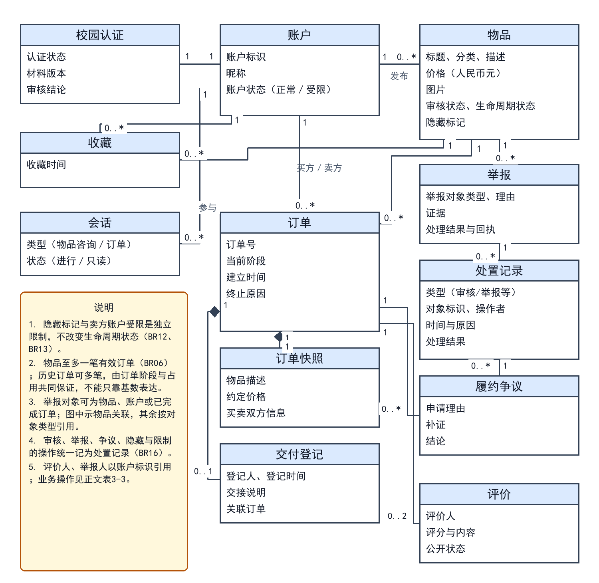
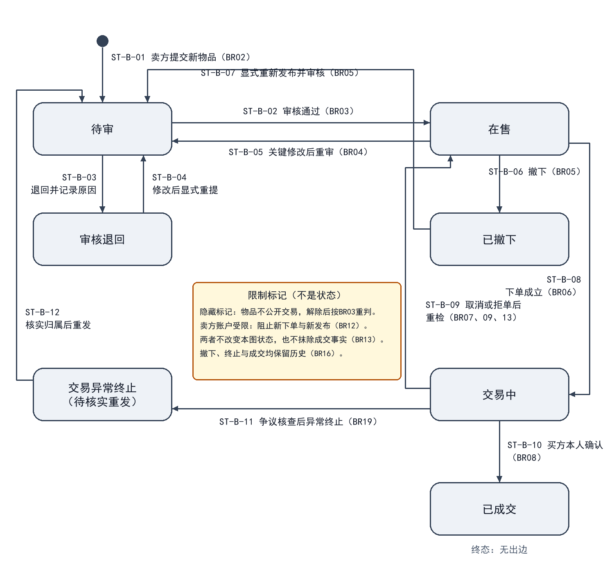
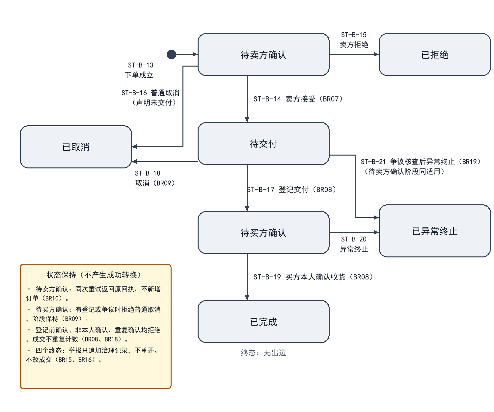
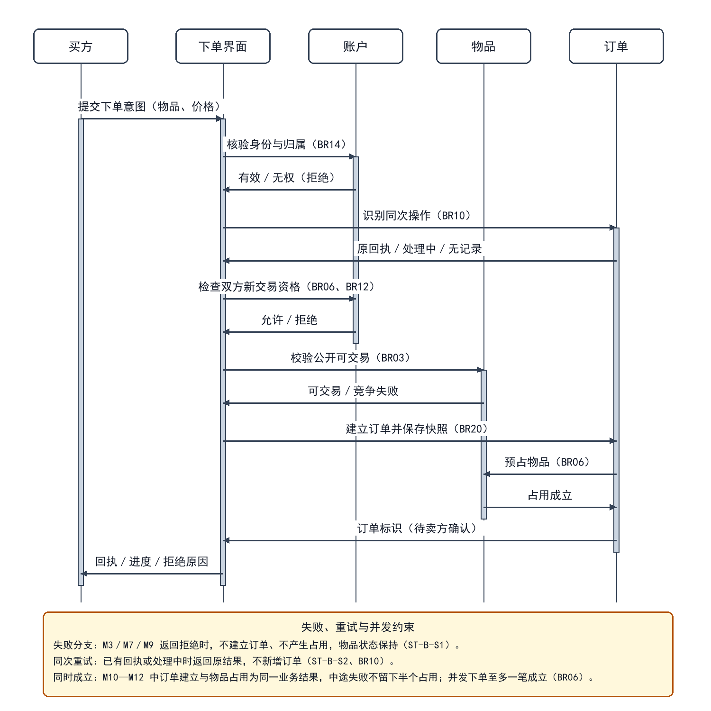

# 校园二手交易与物品流转平台需求规格说明书

本说明书规定校园二手交易与物品流转平台的业务范围、用户任务、交易规则及管理权限，为系统分析、交互设计和需求验收提供依据。

## 1 项目概述

### 1.1 业务问题与项目背景

校园教材、学习工具、数码配件和生活用品具有阶段性使用特点。平台面向校园内部用户，将闲置物品的信息发布、检索咨询、交易确认和线下交付记录集中管理，并通过评价、举报和审核处置维护交易秩序。平台以单件实物交易为对象，重点解决信息难以集中发现、同一物品重复承诺、交付责任不清和违规处置影响既有订单等问题。

### 1.2 业务目标与成功指标

- 信息可发现：用户能够按关键词和分类找到符合公开条件的物品，查看完整描述，并向卖方咨询。

- 交易不重复：同一物品至多关联一笔有效订单；重复提交不增加订单，竞争失败不留下额外占用。

- 过程可追踪：审核、接单、交付登记、收货确认和争议处置均可关联原物品、订单与操作记录。

- 责任可区分：卖方登记交付，买方确认收到；管理员负责治理和争议结案，不得冒用当事人身份确认收货。

### 1.3 涉众、业务角色与确认责任

买方和卖方是校园用户在具体交易中的身份，同一账户可以在不同交易中承担不同身份。权限以对象归属和订单阶段判断，不因拥有某种身份便可操作他人的记录。

- 访问者：浏览公开物品并申请注册；不能执行发布、下单或其他需认证的操作。

- 校园用户：完成校园身份核验后使用交易服务。卖方对物品描述和交付登记负责，买方对购买意图和收货确认负责；双方可查看本人交易并参与争议处理。

- 管理员：审核校园资格与物品发布，处理举报和争议，实施隐藏、账户限制及恢复，并查看职责范围内的统计。

- 项目成员与课程评阅者：依据业务资料和需求条目检查范围、规则与成果。业务规则变更须保留决定、影响及版本记录。

### 1.4 产品范围、非目标与业务概览

平台包括用户准入、物品发布审核、搜索筛选、收藏咨询、下单确认、线下交付记录、评价举报、账户治理、状态流转及统计。主路径为发布审核、下单预占、卖方接单、线下交付、买方确认和评价；取消与争议处理为交易提供退出路径。

图1-1 系统上下文图

图1-1明确系统与线下交接的边界。验货、实物交付和款项结算由当事人完成，平台保留操作及处置记录。本期不含在线支付、资金托管、快递、商家入驻、拍卖、多库存及登录凭据找回；凭据恢复留后续迭代，不等同UC11账户解封。图源与导出见附件索引E-A-06。

### 1.5 资料来源与编写依据

- SR01 选题与功能范围：《实践项目说明(1).pdf》第2页“校园二手交易与物品流转平台”核心功能第1—10项规定功能范围；FR01—FR24承接该范围，具体交易条件由第4章统一规定。

- SR02 结构与分工：仓库initialization/skills/共同大纲.md（v3.3）的分工、图表责任及第1—8章；采用main提交366b8b5中的目录框架。

- SR03 验证与提交：initialization/docs/提交要求对照.md及课程验证报告“提交材料说明”、A.2—A.8、B.2—B.4。附件入口为attachments/A/附件索引.md；逐项依据及核验记录独立维护。

- SR04 表达参考：《自习室预约管理系统需求分析报告.docx》封面日期2025年11月5日，第2—5章仅用于参考功能分组、用例步骤与图文说明形式。

### 1.6 运行条件、外部依赖与约束

用户通过浏览器使用平台，校园资格经平台核验后生效。身份材料仅用于资格审核，不作为公开资料展示。交易依赖线下实物交接，系统确认表示业务记录成立，不表示平台已代为付款或检验物品质量。通知用于告知处理结果，送达失败不撤销已经成立的订单或处置，用户可在本人记录中查询。实现方案不得改变本说明书规定的身份、归属和交易结果。

## 2 用户需求

### 2.1 功能范围、需求清单与优先级

P1表示准入与交易闭环所必需的功能，P2表示支撑使用与治理的功能。优先级用于安排实现顺序，需求清单中的各项能力均属于本期范围。

表2-1 功能需求清单

| 编号 | 角色／触发 | 系统应提供的行为与结果 | 优先级 | 关联 |
| --- | --- | --- | --- | --- |
| FR01 | 访问者 | 注册账户并反馈成功或拒绝原因 | P1 | UC01／BR01 |
| FR02 | 注册用户 | 提交认证、查退回原因、修改后重提 | P1 | UC01／BR01、10 |
| FR03 | 卖方 | 提交包含必要描述和价格的物品供审核 | P1 | UC04／BR02、03 |
| FR04 | 管理员 | 通过或退回待审物品并保留原因 | P1 | UC10／BR03、16 |
| FR05 | 卖方 | 修改本人可修改物品，按变更范围执行重审 | P1 | UC04／BR04 |
| FR06 | 卖方 | 撤下本人尚无有效订单占用的物品 | P2 | UC04／BR05 |
| FR07 | 访问者／校园用户 | 检索物品，查看授权公开的卖方资料与评价 | P1 | UC02／BR11、13、14 |
| FR08 | 校园用户 | 收藏、物品咨询及未结束订单的专用沟通 | P2 | UC03、06／BR12、14、17 |
| FR09 | 买方 | 双方账户符合条件时下单，唯一建立订单和预占 | P1 | UC05／BR06 |
| FR10 | 卖方 | 接受或拒绝本人收到的待卖方确认订单 | P1 | UC06／BR07 |
| FR11 | 交易当事人 | 按登记、未交付声明及争议条件取消并留痕 | P1 | UC07／BR09 |
| FR12 | 系统 | 按订单终止原因及独立限制决定物品是否可交易 | P1 | UC07、10／BR05、12、13、19 |
| FR13 | 卖方 | 对待交付订单如实登记线下交付 | P1 | UC06／BR08 |
| FR14 | 买方 | 对本人已登记交付订单确认收到物品 | P1 | UC06／BR08、14 |
| FR15 | 交易当事人 | 查本人订单进度，登记后可提醒并申请处理 | P1 | UC06、10／BR14、16、19 |
| FR16 | 交易当事人 | 提交合资格评价，并按范围展示或查看 | P2 | UC08／BR11、14 |
| FR17 | 校园用户 | 对物品或违规行为提交举报并查本人处理结果 | P2 | UC09／BR15 |
| FR18 | 管理员 | 关联核查同事件举报，保留各条回执与依据 | P2 | UC10／BR15、16 |
| FR19 | 管理员 | 限制或恢复违规账户并记录原因及依据 | P2 | UC11／BR12、16 |
| FR20 | 系统 | 阻止受限账户及其物品建立新交易，保留旧单处理 | P1 | UC11／BR12 |
| FR21 | 管理员 | 按明确统计口径查看发布、成交与治理数据 | P2 | UC12／BR18 |
| FR22 | 系统 | 对审核、关键交易和治理操作保留可关联记录 | P1 | UC04—UC12／BR16 |
| FR23 | 注册用户 | 登录退出本人会话；本期不含凭据找回和重置 | P1 | UC01／BR01、14 |
| FR24 | 交易当事人／管理员 | 处理未结束订单履约争议、补证及结案 | P1 | UC10／BR15、19 |

### 2.2 用户故事与角色场景覆盖

用户故事说明角色希望获得的业务价值，用于安排需求优先级；用例说明实现该目标时的触发、前提、交互、异常与结果。两者通过FR和UC编号关联，允许一对多或多对一；具体步骤见2.3—2.4，业务规则统一引用第4章。

- US01 发现与沟通：作为校园用户，希望检索并咨询目标物品，以判断是否适合购买。关联FR07—08、UC02—03。

- US02 发布与维护：作为卖方，希望提交准确的物品信息并获知审核结果，以便合法、清晰地展示物品。关联FR03—06、UC04、UC10-a。

- US03 建立交易：作为买方，希望一次下单形成唯一订单，避免一件物品被重复承诺。关联FR09、UC05。

- US04-a 交付与收货：作为交易当事人，希望沟通交接、登记交付并获知待确认进度，以便完成交接和保留凭据。关联FR08、FR10、FR13—15、UC03-b、UC06。

- US04-b 取消交易：作为交易当事人，希望在未实际交付且系统允许的阶段取消订单并获知结果，以便结束不再履行的交易。关联FR11—12、UC07。

- US04-c 争议处理：作为交易当事人，希望对未结束订单提交履约争议并获知处理结果，以便恢复履约或结束无法继续的交易。关联FR24、UC10-b。

- US05-a 评价与举报：作为校园用户，希望评价已完成交易或举报违规行为，以便反馈交易体验并维护交易秩序。关联FR16—17、UC08—09。

- US05-b 审核与治理：作为管理员，希望审核物品、处理举报并限制违规账户，以便执行平台规则并保留处置依据。关联FR04、FR18—20、FR22、UC10—11。

- US05-c 运营统计：作为管理员，希望按统一口径查看发布、成交和治理数据，以便掌握平台运行情况。关联FR21、UC12。

- US06 账户与资格：作为校园用户，希望注册、完成校园认证并安全登录和退出，以便使用本人有权访问的交易服务。关联FR01—02、FR23、UC01。

场景覆盖包括正常主流程、权限拒绝、状态变化和异常恢复：访问者核验失败时不能下单；卖方审核退回后可修改重提；买方竞争失败不产生占用；当事人可在允许阶段取消，交付有争议时转处理流程；管理员的隐藏与账户限制不得抹除历史交易。

### 2.3 用例模型及说明位置

图2-1 UML用例图

图2-1中，管理员参与UC01校园认证审核；用户参与UC10本人举报、争议和补证。UC01、UC03、UC04、UC10为概览分组，子流程分别规定触发、条件和结果；旧单沟通仍由交易双方参与，不增加治理权限。图源与导出见附件索引E-A-07。

- UC01-a 注册：访问者提交账户资料；账户标识未被占用时建立账户，重复标识或缺少必要资料时拒绝，不授予认证权限。

- UC01-b 校园认证：用户提交本人资格材料，管理员审核当前版本；退回须说明原因。用户可修改材料并显式重提，系统保存新版本和历次结果，重新进入审核；通过前不授予认证权限，重复重提不新增审核任务。关联FR02、BR01、BR10。

- UC01-c 登录：凭据正确时建立本人会话；凭据错误不得登录，未认证者不获交易权限。本期不含忘记密码找回、凭据重置及无法登录后的自助恢复，列入后续迭代；认证重提或重新注册不能绕过旧账户限制。关联FR23、BR01、BR12。

- UC01-d 退出：已登录用户主动退出时终止本人会话；会话失效后不得沿用旧身份操作，重新登录后按当前资格判断权限。关联FR23、BR01。

- UC02 检索浏览：访问者或用户查询公开可交易物品，无结果返回空列表；隐藏、成交或卖方受限的物品不提供交易入口。公开卖方信息仅含昵称、有效校园认证标记及已公开评价，不展示真实姓名、学号、认证材料、联系方式或私有订单。关联FR07、BR13—14。

- UC03-a 收藏：认证用户收藏或取消收藏，维护本人唯一关系；对象不可访问时拒绝，不形成交易占用。

- UC03-b 沟通：有资格用户可就物品发起咨询；订单双方可在未结束订单中打开专用会话，沟通交接或核查事项，受限账户也保留此权利。订单结束后该会话只读，举报补证另走UC10；不得借旧单发起无关新交易。关联FR08、FR15、BR12、BR14、BR17。

- UC08 评价：完成订单双方各可评价一次，重复提交不追加。访问者和用户可查看卖方信息区的已公开交易评价；当事人可在本人订单中查看该单评价。治理隐藏的评价不公开展示，评价不得暴露私有订单、身份材料或联系方式。关联FR16、BR11、BR14。

- UC09 举报：用户提交对象、理由及证据并查询本人结果。同对象同事件可关联核查，但各举报保留编号、证据及回执，不向举报人暴露他人身份。终态订单反馈走一般举报，不重开、不新增占用、不改成交。关联FR17—18、UC10-b、BR15—16。

- UC11 限制与恢复账户：管理员依据处置记录限制或恢复账户；限制立即阻止相关新交易，恢复后重新判断全部可交易条件。关联FR19—20。

- UC12 业务统计：管理员选择统计范围，按完成订单及治理记录汇总；不得把预占或交付登记计为成交。关联FR21。

### 2.4 关键详细用例与其他用例摘要

以下用例规定核心流程及业务通过条件。UC04包含发布、关键修改和撤下三个子流程；UC10分别说明发布审核与举报争议处置，二者共享管理入口，不混用触发条件。

#### 2.4.1 UC04 发布与维护物品

参与者与触发：卖方提交新物品、修改本人信息或申请撤下。账户已认证且不受发布限制；修改和撤下还须满足对象归属及订单条件。

（1） 发布：填写标题、分类、描述、价格和图片，系统校验后保存本次提交版本并置为待审，公开列表不展示待审物品。

（2） 修改：无有效订单时，可修改本人描述、图片或价格等关键内容；修改版本重新审核，旧版本的通过结论不沿用。

（3） 撤下：仅对无有效订单的本人物品生效，保留发布与交易历史；再次发布须显式提交并重新审核。

替代与异常：必填缺失或格式错误时保留可安全保留的输入，不生成有效发布；越权、账户受限或占用中撤下均拒绝；同一提交意图重试只产生一次业务效果。

后置结果：新发布或关键修改进入待审；撤下后不可公开交易；失败不改变原物品和有效订单。

业务通过条件：未认证发布被拒绝；待审内容不能下单；有有效订单时不能修改交易标的、价格或撤下；重新提交的审核对象与最新版本一致。 关联：FR03、FR05—06、FR22；BR01—05、BR10、BR13、BR16。

#### 2.4.2 UC05 下单并预占物品

参与者与触发：买方在物品详情确认下单。新意图须满足双方账户有新交易资格、非自买、物品审核通过且无隐藏、撤下、成交及有效占用；已识别的同次操作重试按BR10返回已有结果。

（1） 买方核对描述和价格并提交意图。系统先核验当前登录身份及请求归属，再识别同次操作；已有结果时返回对应回执，不重新执行新下单检查。仅新意图检查双方资格、物品限制及占用。

（2） 系统使订单建立和物品预占同时成立，保存本次物品描述、价格及交易双方信息快照。

（3） 返回待卖方确认的订单标识；双方可以查询本人订单。同次操作尚在处理时返回处理中及查询入口，不另建订单；重试回执附对应订单的当前进度。

替代与异常：新意图遇卖方或买方受限、物品条件变化、自买、越权或竞争失败时拒绝。不同意图不得复用回执，同一意图更改物品或关键内容时拒绝；无权访问的请求不得取得旧回执。

后置结果：成功形成唯一有效订单及对应占用；失败不产生孤立订单或残留占用。

业务通过条件：两人竞争同一物品时至多一笔成功，失败不留占用；成功后丢失响应，再以同次意图重试，应返回原订单而非“已占用”；同次处理中的请求不新增订单；受限卖方物品不能接收新意图。关联FR09、FR15、FR20、FR22；BR06、BR10、BR12—14、BR20。

#### 2.4.3 UC06 确认交易与登记交付

参与者与触发：卖方处理本人待卖方确认订单；接受后双方开展线下交接。各操作必须符合订单当前阶段，订单不是已终止或已完成状态。

（1） 卖方接受后进入待交付，双方可用订单专用会话约定交接；账户受限仍可就旧单沟通。拒单按独立限制判断物品可售性。

（2） 双方在线下验货并交接物品及款项后，卖方及时提交交付登记；系统保存记录并进入待买方确认。实际交付尚未登记时，应补登记；对交付事实有分歧时按UC10-b核查。

（3） 买方核实收到物品后由本人确认，系统同时记录订单完成与物品成交，并保留双方查询和评价入口。

替代与异常：越权、管理员代确认、登记前收货均拒绝。登记后买方未回应时，卖方可发起一次站内提醒并申请管理员处理；同一待确认阶段重复提醒不新增通知。期间保留阶段与占用，不自动成交或取消。关联UC10-b、BR19。

后置结果：交付登记不等于成交；买方确认后才完成。争议处理可继续履约、确认收到后结案，或异常终止。

业务通过条件：登记不计成交；买方本人确认后仅计一次。受限账户仍可沟通旧单；提醒或申请处理不改变交易结果，管理员不得代收货。关联FR08、FR10、FR13—16、FR22、FR24；BR07—08、BR10—12、BR14—19。

#### 2.4.4 UC07 取消交易

参与者与触发：当事人申请结束本人待卖方确认或待交付订单，并声明尚未实际交付。卖方拒单与普通取消分别留痕。平台以交付登记、争议标记及该声明判断资格，不自动识别线下事实。

（1） 核对订单、归属及取消影响。仅尚无交付登记、无处理中争议，且当事人声明未实际交付时，才进入普通取消；任何一方报告已实际交付或双方陈述冲突时，阻止普通取消并转争议核查。

（2） 当事人提交原因并确认后，系统再次核对阶段、交付登记及争议标记，将取消结果和解除本订单占用作为同一业务结果记录，并保留操作者、时间和未交付声明。

（3） 重新检查审核、隐藏、撤下、成交事实和卖方账户资格，符合全部条件时才恢复可交易；保留订单历史。

替代与异常：已有交付登记、已结束或争议处理中的订单不得普通取消；实际已交付但未登记的，应补登记或提交争议。取消与交付登记并发时，以系统先成立的合法操作为界；后成立请求拒绝，不覆盖原结果。

后置结果：取消成功不再形成有效占用，但不会解除独立隐藏、撤下或账户限制；拒绝不改变原业务结果。

业务通过条件：已有登记则取消被拒绝；取消先成立则后续交付登记被拒绝；未登记但已报告实际交付时不得普通取消；隐藏或封禁后取消不恢复物品可售。关联FR11—12、FR15、FR22；BR05、BR09—10、BR12—13、BR15—16。

#### 2.4.5 UC10 审核与违规处置

参与者与触发：管理员审核发布，或核查举报、未结束订单争议及登记后未回应的处理申请。用户可提交本人申请和补证；履约争议仍限待卖方确认、待交付、待买方确认阶段。

（1） UC10-a发布审核：核对发布资格和当前提交内容，记录通过或退回及原因；通过后仍检查独立隐藏、撤下、成交、账户和占用条件。

（2） UC10-b举报与争议：登记对象、理由和证据；同对象同事件可关联处理，保留每条记录及各自回执，不同事实不得强行合并。未结束订单履约分歧走争议，终态反馈走一般举报，不重开或新增占用。

（3） 受理争议或未回应申请后保留原阶段及已有占用，指定管理员联系双方、核查交付和补证。同一对象新增证据须核对已有结论，不因已关联或已结案而直接忽略；举报数量不直接判定违规。

（4） 核查后可恢复履约，或在卖方登记后由买方本人确认完成；有无法履约或争议无法消除的核查依据时可异常终止。买方未回应不视为收货，也不单独构成异常终止依据，不执行超时自动成交。

替代与异常：越权、目标不存在或无理由处置均拒绝。证据不足时进入补证核查，不直接判定违规；继续履约失败可转异常终止，不能把争议永久悬置作为处理结果。

后置结果：未结束订单异常终止时解除原订单占用，但物品保持不可交易；核实持有或退还情况后，卖方方可重发审核。已结束订单举报仅追加治理记录，不撤销历史成交。资金由双方线下处理，平台不退款。

业务通过条件：申请有责任人和查询结果，催办不代收货；关联举报各保留证据和回执；异常终止不计成交且不直接恢复可售；终态举报不重开、不改成交。关联FR04、FR15、FR17—20、FR22、FR24；BR03、BR12—16、BR18—19。

### 2.5 任务交互、页面流程与反馈

### 2.6 外部接口与人工交接

## 3 领域与数据

### 3.1 统一术语与关键参数引用

本章统一业务概念、分析类、对象关系、职责和关键数据。业务规则及其数值以第4章为权威定义，本章只引用BR编号，不另立规则；表中"待确认"不等于已确认参数，也不因写入模型或图形而升级。

表3-1 术语与关键参数表

| 术语／参数 | 含义与取值口径 | 适用条件 | 来源与确认状态 |
| --- | --- | --- | --- |
| 单件物品 | 一次发布对应一件实物，不设库存数量与拆分 | 发布、下单、统计 | BR02；本期不含赠送与多库存 |
| 当前版本 | 物品最近一次提交并接受审核的内容 | 审核、修改、公开 | BR03、BR04 |
| 审核通过 | 管理员对当前版本作出的通过结论，不解除其他限制 | 公开可交易的前提之一 | BR03 |
| 公开可交易 | 当前版本审核通过且未隐藏、未撤下、未成交、无有效占用、卖方未受限 | 列表展示与下单入口 | BR03、BR13 |
| 有效订单 | 已建立且未取消、拒绝、异常终止或完成的订单 | 判断唯一占用与当前阶段 | BR06 |
| 占用（预占） | 有效订单对物品的排他交易资格，随订单建立同时产生 | 下单、取消、拒单、终止、完成 | BR06、BR09、BR19 |
| 订单阶段 | 待卖方确认、待交付、待买方确认三个未结束阶段 | 当事人操作与争议受理 | BR07—BR09、BR15 |
| 交付登记 | 卖方就待交付订单提交的线下交接记录 | 登记后进入待买方确认，不构成成交 | BR08 |
| 成交 | 买方本人确认收货后，订单完成与物品成交同时成立 | 统计与评价资格 | BR08、BR11、BR18 |
| 关键修改 | 描述、图片、价格等影响交易标的的修改 | 重新审核；有有效订单时禁止 | BR04 |
| 履约争议 | 未结束订单当事人就交付或履约提出的处理申请 | 限三个未结束阶段；受理保留阶段与占用 | BR15、BR19 |
| 受限账户 | 被管理员限制新交易资格的账户 | 保留旧单必要处理权 | BR12 |
| 隐藏、撤下 | 隐藏为管理员治理标记；撤下为卖方主动结束展示 | 均为独立限制，不改变生命周期状态 | BR05、BR13；模型见3.3、5.2 |
| 快照 | 订单成立时保存的物品描述、约定价格与双方信息 | 后续修改不回写历史约定 | BR20 |
| 价格与金额 | 人民币元，单件正数总价；统计按约定金额合计 | 发布、订单、统计 | BR02、BR18；款项由双方线下结算 |
| 评价次数 | 每个完成订单的买卖双方各1次 | 未完成或异常终止不得新增 | BR11 |
| 提醒次数 | 同一待买方确认阶段至多1次站内提醒 | 提醒不构成收货证据 | BR19；定时催办暂缓 |
| 记录保留 | 审核、交易、处置与争议记录保留操作者、对象、时间、原因和结果 | 取消、隐藏、限制、终止不删除历史 | BR16 |
| 成交统计 | 按完成订单去重，预占、登记、取消、拒绝与异常终止不计 | 隐藏或结案不冲减 | BR18；统计周期待确认（TBD-B-01） |

术语只在3.1定义一次，其余章节直接引用。价格、次数和记录字段的数值口径来自4.1，本章不重复解释取舍理由；统计周期与截止时点、审核及争议的处理时限、通知重试策略三项尚无业务依据，分别记为TBD-B-01—TBD-B-03，账户注销与数据删除要求记为TBD-B-04（见3.5），由a组织业务确认并交D纳入8.3，确认前保留现描述。

### 3.2 核心分析类识别与取舍

候选对象从UC01—UC12、FR01—FR24和BR01—BR20中提取，按"是否有业务事实需要长期保存、是否承担判断或行为职责"决定保留、合并或排除。界面控件、技术组件和外部服务不作为分析类；业务操作在3.4说明，图中不列方法。

表3-2 分析类识别与取舍表

| 候选对象 | 主要来源 | 处理 | 关键属性或职责要点 | 取舍理由 |
| --- | --- | --- | --- | --- |
| 账户 | UC01、UC11；BR01、BR12、BR14 | 保留（实体类） | 账户标识、昵称、账户状态 | 资格与归属判断的主体；昵称与认证属公开边界 |
| 校园认证 | UC01-b；BR01、BR14 | 保留（与账户1:1，按版本保留） | 认证状态、材料版本、审核结论 | 需保留退回原因和历次版本，不能并入账户状态 |
| 物品 | UC02—UC07；BR02—BR05、BR13 | 保留（实体类） | 标题、分类、描述、价格、图片、审核状态、生命周期状态、隐藏标记 | 交易标的与公开展示对象 |
| 收藏 | UC03-a；BR17 | 保留（关联对象） | 收藏时间 | 唯一关系，不占用物品、不进入订单 |
| 订单 | UC05—UC07；BR06—BR09、BR20 | 保留（实体类） | 订单号、当前阶段、建立时间、终止原因 | 承载占用、阶段、快照与终态 |
| 订单快照 | BR20 | 保留（订单内组合对象） | 物品描述、约定价格、双方信息 | 历史约定独立于物品后续修改 |
| 交付登记 | UC06；BR08、BR09 | 保留（订单内组合对象） | 登记人、登记时间、交接说明 | 既是取消判断依据，也是成交前提 |
| 评价 | UC08；BR11 | 保留 | 评价人、评分、内容、公开状态 | 完成订单各一次；隐藏保留原记录 |
| 会话 | UC03-b、UC06；BR17 | 保留（消息并入会话记录） | 类型（物品咨询／订单）、状态（进行／只读） | 区分新咨询与旧单履约沟通 |
| 举报 | UC09；BR15、BR16 | 保留 | 对象类型、理由、证据、处理结果 | 与履约争议分流，各自保留回执 |
| 履约争议 | UC10-b；BR15、BR19 | 保留 | 申请理由、补证、结论 | 只适用未结束订单，受理保留阶段 |
| 处置记录 | UC01-b、UC04、UC09—UC11；BR16 | 合并保留（审核、举报、争议、隐藏与限制共用） | 类型、对象标识、操作者、时间、原因、结果 | 同一历史字段，分散建模会重复维护 |
| 物品分类 | FR03、UC02 | 并入物品受控属性 | 分类名称 | 本期无独立分类维护需求，避免空类 |
| 通知 | 1.6、UC06 | 不作为业务对象（外部接口，见2.6） | 送达状态 | 通知失败不撤销业务结果 |
| 统计结果 | UC12；BR18 | 不作为持久对象（计算值） | 指标值与口径 | 需求阶段只定义计算口径 |
| 支付、物流、库存、拍卖 | 1.4非目标 | 排除 | — | 不在本期范围 |

边界类为下单界面、物品详情与审核界面，只承担输入输出；控制职责分散在对象协作中，下单由订单与物品共同完成，不设承担全部判断的"系统类"。数据表结构、索引与实现类留待设计阶段，不在本章确定。

### 3.3 对象关系、数量与领域模型

图3-1按业务概念组织领域类，只表达类、关键属性、关联与基数；界面、数据库表、索引和技术构件不在图中。业务操作集中列在3.4的表3-3，避免图中方法与正文不一致。

图3-1 领域类图

本图建模对象为账户、校园认证、物品、收藏、订单、订单快照、交付登记、评价、会话、举报、履约争议和处置记录，关联FR01—FR24、UC01—UC12与BR02—BR20；源与导出见附件索引E-B-01。

账户与对象的关系按业务角色区分：账户发布物品为1:0..*，账户在订单中可承担买方或卖方，均为1:0..*；收藏是账户与物品之间的关联对象，同一账户对同一物品至多一条收藏关系，收藏不产生占用（BR17）。会话按类型区分物品咨询与订单专用会话，图中以会话类型和关联对象表示，未重复画线与物品、订单相连，避免与参与关系重复。

物品与订单为1:0..*，表示同一物品可以有多笔历史订单；"至多一笔有效订单"（BR06）不能只靠基数表达，因为取消、拒绝、异常终止和完成的订单仍需保留。该限制由订单阶段与物品占用共同保证：订单建立与物品占用同时成立（ST-B-08、ST-B-13）；取消或拒单后物品重新检查可售条件（ST-B-09）；争议核查异常终止时释放占用，但物品保持不可交易（ST-B-11）；买方确认后订单完成、物品成交（ST-B-10、ST-B-19）。图5-3、图5-4与表5-2必须成组核对，任一处只改基数或只改状态都会产生不一致。

订单由订单快照、交付登记、评价和履约争议组成或关联：订单与快照为1:1组合，快照保存成立时的物品描述、约定价格与双方信息（BR20）；订单与交付登记为1:0..1组合，登记存在与否直接影响普通取消的判断（BR09）；订单与评价为1:0..2，完成订单的买卖双方各一次（BR11）；订单与履约争议为1:0..*，争议只在未结束阶段受理（BR15、BR19）。

举报以"对象类型＋对象标识"引用被举报对象，图中示出与物品的关联；账户和已完成订单的举报复用同一记录结构。举报与履约争议都关联处置记录（1:0..*），发布审核、隐藏、限制与解封也写入同一类处置记录，保留操作者、时间、原因和结果（BR16），从而避免为每类操作重复建表或丢失历史。

隐藏标记与账户受限是独立限制，不进入物品生命周期状态：物品被隐藏后仍保持原状态，只是不满足公开交易条件；账户解封也不解除物品的隐藏、撤下或成交事实（BR03、BR12、BR13）。该区分与5.2的状态定义和5.3的转换表一致，模型不得把"隐藏"画成物品状态转换。

关系不因业务终止而删除：取消、拒绝、异常终止、隐藏和封禁保留原订单、交付登记、评价与处置记录；订单快照只读，物品资料后续修改不回写历史约定。

### 3.4 对象职责与用例覆盖

表3-3 类职责表

| 类 | 业务信息职责 | 判断职责 | 行为职责 | 不承担 |
| --- | --- | --- | --- | --- |
| 账户 | 身份标识、昵称、账户状态 | 是否具备新交易、发布与收藏资格（结合BR12） | 保存账户状态与限制结果 | 不判断订单阶段，不代替管理员处置 |
| 校园认证 | 材料版本、认证状态与审核结论 | 当前版本是否通过认证 | 保存历次版本与结果 | 不直接授予交易权限，权限按BR01判断 |
| 物品 | 描述、价格、审核状态、生命周期状态、隐藏标记 | 是否满足公开可交易条件（BR03） | 保存提交版本，按审核与订单结果改变状态 | 不建立订单，不创建或释放占用 |
| 收藏 | 账户与物品的收藏关系、收藏时间 | 是否已收藏 | 建立或取消收藏 | 不占用物品，不参与交易 |
| 订单 | 阶段、建立时间、终止原因、订单快照 | 当前阶段允许哪些操作（BR07—BR09、BR19） | 建立、接受、拒单、推进、取消、异常终止、完成 | 不判定线下事实，不改物品审核结论 |
| 订单快照 | 成立时的物品描述、约定价格与双方信息 | — | 保存成立时内容，供历史查询 | 不回写物品，不随后续修改变化 |
| 交付登记 | 登记人、时间、交接说明 | 是否存在有效登记（取消前提） | 保存登记记录 | 不产生成交，不代替买方确认 |
| 评价 | 评价人、评分、内容、公开状态 | 是否具备评价资格（BR11） | 记录、公开或隐藏评价 | 不影响订单阶段与成交统计 |
| 会话 | 会话类型、进行或只读状态 | 参与人范围与是否可继续发送 | 打开、关闭、转只读 | 不改变交易状态，不形成新承诺 |
| 举报 | 对象类型、理由、证据、处理结果 | 对象是否存在、是否可受理 | 登记举报、生成回执 | 不重开订单，不直接判定违规 |
| 履约争议 | 申请理由、补证、结论 | 是否属未结束订单、是否受理 | 受理、记录核查、结案 | 不代替管理员裁决，不自动退款 |
| 处置记录 | 类型、对象标识、操作者、时间、原因、结果 | — | 追加记录，供查询与统计 | 不删除或覆盖历史记录 |

表3-4 用例—职责覆盖表

| 用例 | 主要对象协作 | 覆盖说明与检查结果 |
| --- | --- | --- |
| UC01 注册、校园认证与会话 | 账户、校园认证、处置记录 | 账户建立与认证版本审核均有承担对象；退回原因写入处置记录 |
| UC02 检索与浏览物品 | 物品（账户公开资料） | 公开条件由BR03、BR13、BR14约束，物品承担状态与展示判断 |
| UC03 收藏与交易咨询 | 收藏、会话、物品、账户 | 收藏唯一且不占用；咨询会话与订单会话以类型区分 |
| UC04 发布与维护物品 | 物品、处置记录 | 发布版本、关键修改和撤下均落在物品状态与审核记录 |
| UC05 下单并预占物品 | 订单、物品、账户、订单快照 | 订单建立与占用同时成立，见图5-5；失败不产生孤立对象 |
| UC06 确认交易与登记交付 | 订单、交付登记、物品、会话 | 登记与成交分开；买方确认后订单完成、物品成交 |
| UC07 取消交易 | 订单、物品、处置记录 | 释放占用后重检独立条件，物品不自动恢复可售 |
| UC08 评价交易 | 评价、订单 | 按完成订单各一次；隐藏保留原记录 |
| UC09 举报违规 | 举报、处置记录 | 终态举报只追加治理记录，不重开订单 |
| UC10 审核与违规处置 | 履约争议、处置记录、订单、物品 | 受理保留阶段与占用；异常终止释放占用但物品不可售 |
| UC11 限制与恢复账户 | 账户、处置记录 | 限制保留旧单必要权利，解封不解除物品独立限制 |
| UC12 查看业务统计 | 订单（计算）、处置记录 | 按BR18口径计算，不建立持久统计对象 |

检查结果：每个核心用例都有承担判断与保存事实的对象，未发现无人承担的行为；职责没有集中在单一"系统类"，订单只推进阶段，占用与可售性由物品共同判断。UC02、UC12主要由查询和计算完成，不新增持久对象。跨对象约束在5.3和表4-2中核对，不在此重复规则。

### 3.5 关键数据字典与记录生命周期

表3-5只列业务数据项的含义、约束、维护角色、隐私属性与访问规则，不规定数据库类型、索引和加密实现。隐私属性分为公开、私有、当事人私有、治理敏感和高度敏感；访问规则均以BR14的归属判断为前提。

表3-5 关键数据字典

| 数据项 | 含义与来源 | 约束 | 维护角色 | 隐私属性 | 访问规则 | 关联 |
| --- | --- | --- | --- | --- | --- | --- |
| 账户标识 | 注册时生成的唯一标识 | 唯一、不复用 | 系统 | 非公开 | 本人及必要治理查询 | FR01；BR14 |
| 昵称 | 平台展示名称 | 不含真实姓名、学号等私有信息 | 用户 | 公开 | 公开交易页可见 | BR14 |
| 账户状态 | 正常或受限，来自治理决定 | 变更须有原因和记录 | 管理员 | 治理敏感 | 本人可见状态；处置依据限治理范围 | FR19；BR12、BR16 |
| 校园认证材料 | 用于资格审核的材料及版本 | 仅用于审核，不公开；历次版本保留 | 用户提交、管理员审核 | 高度敏感 | 审核必要范围，不展示、不导出 | FR02；BR01、BR14 |
| 认证状态与结论 | 通过或退回及原因 | 退回可按原因修改并重提 | 管理员 | 当事人敏感 | 本人可见 | BR01 |
| 物品标题、分类、描述、图片 | 公开发布内容 | 单件实物、必填、不含私有信息 | 卖方 | 公开 | 公开列表与详情 | FR03；BR02、BR14 |
| 物品价格 | 人民币元正数，单件总价 | 大于零；订单成立后以快照为准 | 卖方 | 公开（成交前） | 公开详情；历史按快照 | BR02、BR20 |
| 审核状态 | 待审、通过或退回 | 以当前版本判断，旧结论不沿用 | 管理员 | 治理敏感 | 本人及治理范围 | BR03、BR04 |
| 生命周期状态 | 物品当前所处状态 | 只能按表5-2转换 | 系统按规则变更 | 部分公开 | 公开页只展示在售 | BR03、BR13 |
| 隐藏标记 | 管理员隐藏的原因与结果 | 独立限制，不改变生命周期状态 | 管理员 | 治理敏感 | 公开页不展示；本人与治理可查 | BR13、BR16 |
| 占用 | 有效订单对物品的排他资格 | 至多一个，随订单成立或终止 | 系统 | 交易信息 | 当事人及治理必要范围 | BR06 |
| 订单号与阶段 | 订单标识与当前阶段 | 阶段只能按表5-2转换，终态不重开 | 系统 | 当事人私有 | 当事人及治理必要范围 | FR15；BR08、BR14 |
| 订单快照 | 成立时的物品描述、约定价格和双方信息 | 只读，不回写物品 | 系统 | 当事人私有 | 当事人及治理必要范围 | BR20 |
| 交付登记 | 登记人、登记时间、交接说明 | 仅待交付阶段；登记后不得普通取消 | 卖方 | 当事人私有 | 当事人及治理必要范围 | BR08、BR09 |
| 评价 | 评价人、评分、内容、公开状态 | 完成订单各一次；公开内容不含私有信息 | 买方或卖方 | 已公开评价可公开，其余当事人私有 | 卖方公开信息区或当事人、治理范围 | BR11、BR14 |
| 会话与消息 | 类型、参与人、内容、只读状态 | 仅相关双方；订单终态后只读 | 当事人 | 当事人私有 | 参与双方；治理按需访问并留痕 | BR14、BR17 |
| 举报 | 对象类型与标识、理由、证据、处理结果、回执 | 举报人身份不向被举报人公开 | 校园用户提交、管理员处理 | 敏感 | 本人回执；治理必要范围 | BR15、BR16 |
| 履约争议 | 订单、申请理由、补证、结论 | 仅未结束订单；受理保留阶段与占用 | 当事人申请、管理员处理 | 当事人私有兼治理敏感 | 当事人及治理必要范围 | BR15、BR19 |
| 处置记录 | 类型、对象标识、操作者、时间、原因、结果 | 追加不删除，关联原对象 | 管理员、系统 | 治理敏感 | 授权治理范围；当事人可见本人事项结果 | BR16 |
| 成交统计 | 完成订单去重后的笔数与约定金额合计 | 口径固定，周期边界待确认（TBD-B-01） | 系统计算 | 聚合数据 | 管理员职责范围 | BR18 |
| 收藏 | 账户与物品的唯一关系及收藏时间 | 唯一；不占用物品 | 校园用户 | 私有 | 本人 | BR17 |

记录生命周期按"追加事实、保留历史、按需限制展示"处理：

- 创建与修改：物品按提交版本保存，关键修改产生新版本并重新审核；认证材料同样按版本保留；订单、交付登记、评价、举报、履约争议与处置记录均为追加记录。
- 保留与更正：取消、拒绝、异常终止、隐藏、限制和结案不删除原对象与记录；需要更正时追加说明，不覆盖原操作者和时间。订单快照自成立起只读。
- 会话状态：订单进入终态后会话转只读，不新增交易承诺；举报补证另走UC10，不在会话中改变订单状态。
- 统计：统计值为计算数据，按BR18口径生成；导出或展示时注明口径与截止时点，不单独保存另一套历史口径。
- 删除与匿名化：本期不提供用户自助删除，账户注销与数据删除请求尚未规定，记为TBD-B-04，由a组织确认；在确认前，任何处理都不得破坏订单、交付、评价与治理历史。
- 隐私最小化：公开信息只含昵称、已审核物品内容、有效认证标记和已公开评价；真实姓名、学号、认证材料、联系方式和交接地点不公开，管理员仅因审核治理按需访问并留痕。

## 4 规则与权限

### 4.1 允许、禁止与计算规则

以下规则统一约束用例、状态变化、交互和验收。规则条件同时适用时，应满足全部条件；旧订单的必要处理权按BR12保留。

- BR01 校园准入：注册、认证和登录分开。认证退回可按原因修改并显式重提，新版本重新审核、旧记录保留；通过前不授予认证权限。公开浏览无需认证；会话失效不允许私有操作，凭据恢复不在本期范围。

- BR02 发布内容：单件实物须具备标题、分类、描述、正数人民币价格和必要图片；本期不含免费赠送及多库存销售。

- BR03 审核门槛：物品仅在当前版本审核通过、未隐藏、未撤下、未成交、无有效占用且卖方未受限时公开交易。审核通过不解除其他限制。

- BR04 关键修改：描述、图片和价格等关键修改重新审核；有效订单存在时禁止改变标的及约定价格。旧审核结论不得用于新关键版本。

- BR05 撤下与重发：本人无有效订单的物品可撤下；撤下不删除历史。再次发布需显式提交并审核，不由订单终止自动触发。

- BR06 唯一占用：单件物品至多一笔有效订单，禁止自买。有效订单指已建立且未取消、拒绝、异常终止或完成的订单；建立订单与预占必须同时成立。

- BR07 接单：卖方接受后进入待交付，拒绝则终止本订单；物品是否重新可售须检查全部独立条件。

- BR08 交付与完成：卖方登记待交付订单；平台保存记录后待买方确认。仅该订单买方可确认收到，订单完成与物品成交同时成立；管理员不得代确认。

- BR09 普通取消：待卖方确认或待交付阶段，尚无交付登记、无处理中争议且当事人声明未实际交付时，才可普通取消。已实际交付应补登记；任一方报告已交付或陈述冲突时先转争议。取消与登记以系统先成立的合法操作为准，后续相冲突请求拒绝。

- BR10 重复与竞争：先核验当前身份及请求归属，再按操作者、对象、操作和意图识别重复；已有结果返回原回执，不重跑新操作条件，处理中返回进度。同意图关键内容冲突则拒绝；仅新意图检查资格、限制、阶段及占用。并发同次意图最多成立一次，失败不覆盖已有结果。

- BR11 评价：完成双方各可评价一次，未完成或异常终止不得新增成交评价。卖方信息区的已公开评价允许公开查看，私有订单内评价仅当事人及授权治理人员可查；被隐藏评价不对外展示，保留原记录。公开内容不得含BR14中的私有信息。

- BR12 账户限制：禁止受限账户及其物品新交易、新发布、收藏和物品新咨询；保留旧单查询、允许的取消、交付、收货、旧成交评价和举报。未结束旧单可打开专用会话沟通交接及核查；不得借此联系无关人或开展新交易。恢复账户不解除物品独立限制。

- BR13 展示与限制：公开交易列表只展示符合BR03的物品；本人历史与授权治理查询仍可读。解除占用、解封或结案不抹除成交事实，也不直接解除独立限制。

- BR14 归属与访问：公开卖方信息限昵称、有效认证标记及已公开评价；真实姓名、学号、认证材料、联系方式、私有订单和交接地点不公开。用户仅访问本人业务记录，咨询和订单会话仅相关双方可见；管理员仅因审核治理按需访问并留痕。

- BR15 举报与争议：举报须有对象和理由。同对象同事件可关联核查，各保留编号、证据、回执和隐私，新增证据须复核；数量不等于违规成立。履约争议限未结束订单，受理保留原阶段及占用；终态反馈只追加治理，不重开、不占用。

- BR16 历史与依据：审核、交易、处置与争议记录保留操作者、对象、时间、原因和结果；取消、隐藏、封禁及异常终止不直接删除历史。

- BR17 收藏与沟通：收藏关系唯一且不占用物品；物品咨询按新业务资格判断。未结束订单双方可打开或继续订单专用会话，受限旧单按BR12例外处理；订单结束后会话只读，举报补证另走UC10，沟通不改变交易状态或形成新成交承诺。

- BR18 成交统计：按完成订单去重计算成交笔数和约定金额；预占、交付登记、取消、拒绝及异常终止不计成交。后续隐藏不撤销历史成交。

- BR19 争议出口：未结束订单可恢复履约、由买方确认完成或经核查异常终止。登记后未回应时可提醒并申请处理，期间保持阶段及占用；沉默不等于收货，也不单独作为异常终止依据。终止释放占用但物品仍不可售，核实归属后重发；不自动成交、退款或代收货。

- BR20 交易快照：订单保存成立时的物品描述、约定价格及双方信息快照，资料后续修改不回写历史约定。重复收货或结案不重复计成交。

### 4.2 角色、对象范围与状态权限

权限须同时满足角色、对象归属和当前业务阶段。管理员的治理权不包含买卖双方的事实确认权。受限账户保留旧订单必要权利，但不能据此恢复新交易资格。

表4-1 角色与对象权限矩阵

| 操作 | 访问者 | 正常校园用户 | 受限账户 | 管理员 |
| --- | --- | --- | --- | --- |
| 公开物品／资料／评价 | 按BR11、14 | 按BR03、11、14 | 保留公开查看 | 治理查询另授权 |
| 发布／修改／撤下 | 禁止 | 本人；BR01—05 | 禁止新发布和公开维护 | 审核或隐藏，不冒用卖方 |
| 收藏／物品新咨询 | 禁止 | 本人关系／相关对话 | 禁止；旧记录可查 | 不默认查看全部私聊 |
| 旧单专用沟通 | 禁止 | 未结束订单双方；BR17 | 允许本人旧单交接核查 | 仅治理必要范围访问 |
| 新下单 | 禁止 | 双方未受限；BR06 | 本人及其物品均禁止 | 不得以治理身份代下单 |
| 接单／取消旧单 | 禁止 | 仅当事人；取消按BR09 | 保留原阶段权利 | 争议终止按BR19 |
| 交付／收货／催办 | 禁止 | 卖方登记、提醒；买方确认 | 保留旧单处理权 | 受理申请；不代确认 |
| 查看私有记录 | 禁止 | 本人订单／相关会话 | 保留本人历史 | 审核治理必要范围并留痕 |
| 评价／举报／争议 | 禁止 | 本人评价举报；争议限未结束 | 保留旧成交评价及维权 | 关联核查，不暴露他人举报 |
| 认证／物品审核 | 禁止 | 本人提交；认证退回可改后重提 | 不能绕过限制重提 | 按职责审核当前版本 |
| 隐藏／限制／恢复 | 禁止 | 禁止 | 禁止 | 需授权、原因和记录 |
| 异常终止争议订单 | 禁止 | 未结束订单：申请、补证 | 保留参与权 | 仅BR15阶段；按BR19处置 |
| 业务统计 | 禁止 | 无全局统计权限 | 禁止 | 按职责范围；BR18 |

### 4.3 条件组合、优先级与冲突处理

先核验当前身份和对象／请求归属，再按BR10识别重复：已有回执则返回，处理中则查询，不因后续占用或账户限制改写原结果。仅新意图继续检查资格、审核、独立限制、订单阶段及占用；取消另查未交付声明和争议标记。失败不覆盖其他请求已有结果。

表4-2 关键条件组合及业务结果

| 情境 | 条件 | 处理结果 | 规则 |
| --- | --- | --- | --- |
| C01 正常下单 | 双方有资格、物品可交易 | 一笔订单与一个占用同时成立 | BR03、06 |
| C02 两人竞争／重复 | 同次重试与其他买方新意图区分 | 同次回原结果；新意图竞争失败不占用 | BR06、10 |
| C03 封禁卖方 | 在售物品的卖方受限 | 拒绝新订单；不影响已有订单闭合 | BR12、13 |
| C04 解封卖方 | 账户恢复，其余条件各自检查 | 全部满足才可下单；隐藏或撤下仍有效 | BR03、12 |
| C05 隐藏或封禁后取消 | 本人、无登记及争议，声明未实际交付 | 旧单终止；物品仍受独立限制 | BR09、13 |
| C06 取消与登记竞争 | 以系统先成立的合法操作为界 | 只成立一个相容结果；另一请求拒绝 | BR08—10 |
| C07 已登记交付 | 本人尝试普通取消或管理员代收货 | 均拒绝；保留原结果，可进入争议 | BR08、09 |
| C08 受限旧单处理 | 本人旧单、当前阶段允许 | 允许交接沟通、收货；不放开新咨询 | BR08、12、17 |
| C09 争议恢复／完成 | 未结束订单，含登记后未回应 | 可提醒／申请；沉默不自动完成或终止 | BR15、19 |
| C10 争议异常终止 | 未结束订单，管理员核查后记录依据 | 不计成交；物品不可直接恢复销售 | BR18、19 |
| C11 已交付未登记 | 当事人报告已交付或双方陈述冲突 | 阻止普通取消；补登记或争议核查 | BR08、09、15 |
| C12 终态／重复举报 | 终态反馈，或同对象同事件 | 关联核查并各自回执；不重开或改成交 | BR15、16、18、19 |

## 5 行为与状态

### 5.1 核心业务活动与角色交接

图5-1为新意图下单的成功主路径，重试按BR10；卖方登记后由买方本人确认成交。沟通、未回应处理、取消和争议分别引用BR17、BR19、BR09、BR15，不作为已完成转换。图源与导出见附件索引E-A-08。

图5-1 核心交易主流程泳道图

图5-2从图5-1成功路径之外的入口展开：当事人申请普通取消、催办或提出履约分歧，系统先核验身份、归属与当前阶段；已有交付登记、已报告实际交付或已受理争议时不再走普通取消，转入履约争议核查。取消成立时订单终止并释放占用，但物品是否恢复可交易须重新检查审核、隐藏、撤下、成交和卖方资格（BR03、BR05、BR09、BR13）；争议受理保留原阶段与占用，核查后可继续履约并由买方本人确认完成，或记录依据后异常终止，终止释放占用而物品保持不可交易，须核实归属后由卖方显式重发（BR15、BR19）。账户限制作为并行治理动作，只阻止新交易与新发布，不改变既有订单阶段（BR12）。图源与导出见附件索引E-B-02。

图5-2 异常与状态联动泳道图

本图建模对象为普通取消判定、履约争议处置、异常终止与物品联动，关联UC07、UC10及BR09、BR12、BR13、BR15、BR19；源与导出见附件索引E-B-02。

### 5.2 对象生命周期与状态定义

本节选择物品和订单建立生命周期模型，原因是二者状态多、相互联动，且取消、封禁、隐藏、重复下单的争议集中在两者之间。账户限制、隐藏、争议受理和会话只读是资格或标记，不是生命周期状态；举报、争议的处理进度以记录和结论表达，不另建一套状态机。状态名称全文统一，页面不新增"已隐藏""已下架"等同义状态。

表5-1 对象状态定义表

| 对象 | 状态 | 业务含义 | 进入条件 | 可离开／终态 | 公开可见性 |
| --- | --- | --- | --- | --- | --- |
| 物品 | 待审 | 当前版本等待管理员审核 | 提交新物品或关键修改版本（ST-B-01、04、05、07） | 可到在售、审核退回 | 不公开 |
| 物品 | 审核退回 | 当前版本未通过，等待卖方修改 | 管理员退回并记录原因（ST-B-03） | 可回到待审（ST-B-04） | 不公开 |
| 物品 | 在售 | 审核通过、未撤下、未成交、无有效占用；公开与下单另需无隐藏、卖方未受限 | 当前版本通过（ST-B-02、ST-B-09） | 可到待审、已撤下、交易中 | 无隐藏且卖方正常时公开 |
| 物品 | 交易中 | 存在有效订单，物品被占用 | 新意图下单成立（ST-B-08） | 可到在售、已成交、交易异常终止 | 可见但不可下单 |
| 物品 | 已成交 | 订单完成，物品已售出 | 买方本人确认（ST-B-10） | 终态 | 按历史查询规则可查 |
| 物品 | 已撤下 | 卖方主动结束展示，保留历史 | 卖方撤下（ST-B-06） | 可到待审（显式重发，ST-B-07） | 不公开 |
| 物品 | 交易异常终止 | 订单异常终止后物品不可售，等待核实归属 | 争议核查后异常终止（ST-B-11） | 可到待审（核实后重发，ST-B-12） | 不公开 |
| 订单 | 待卖方确认 | 订单已建立、物品已占用，等待卖方接受 | 下单成立（ST-B-13） | 可到待交付、已拒绝、已取消、已异常终止 | 当事人可见 |
| 订单 | 待交付 | 卖方已接受，等待线下交接与登记 | 卖方接受（ST-B-14） | 可到待买方确认、已取消、已异常终止 | 当事人可见 |
| 订单 | 待买方确认 | 已登记交付，等待买方本人确认 | 卖方登记交付（ST-B-17） | 可到已完成、已异常终止 | 当事人可见 |
| 订单 | 已完成 | 成交成立，可评价 | 买方本人确认收货（ST-B-19） | 终态 | 当事人及已公开评价范围 |
| 订单 | 已取消 | 普通取消成立 | 当事人普通取消（ST-B-16、18） | 终态 | 当事人可见 |
| 订单 | 已拒绝 | 卖方拒绝接单 | 卖方拒绝（ST-B-15） | 终态 | 当事人可见 |
| 订单 | 已异常终止 | 争议核查后终止，解除占用 | 管理员核查后终止（ST-B-20、21） | 终态 | 当事人及治理范围 |

与状态并存的资格和标记如下，它们不产生新的生命周期状态，也不因解除自动恢复可交易：

- 隐藏标记：管理员对物品的治理标记，可出现在在售、交易中、已成交等状态；待审与已撤下本身不公开，隐藏不改变其状态。隐藏期间不公开交易，解除后按BR03重新判断，若已成交或仍有占用，仍不可交易（BR13）。
- 卖方账户受限：资格限制，阻止该账户及其物品的新交易、新发布、收藏和物品新咨询，旧单按BR12保留原阶段权利；解封不解除物品隐藏、撤下或成交事实。
- 争议受理标记：受理履约争议或登记后未回应申请时，订单保留原阶段与占用，不生成"争议中"状态；结案后按裁决走已完成或已异常终止。
- 同次操作处理中：属于请求处理状态，不改变订单阶段；返回处理进度，不新增订单（BR10）。
- 会话只读：订单进入任一终态后会话转只读（BR17），只影响沟通入口，不改变订单与物品状态。

### 5.3 状态转换、拒绝及异常处置

图5-3和图5-4与表5-2同版：图上的每条迁移都标注ST-B编号，表5-2给出当前状态、事件、执行者、条件、目标状态、业务结果和失败处理。拒绝和失败不画成成功转换；当前状态与目标状态同名时，在表5-2中记为"状态保持"，不称转换成功。

图5-3 物品状态机图

本图建模对象为物品生命周期，关联UC04、UC05、UC07、UC10与BR02—BR05、BR13、BR19；源与导出见附件索引E-B-03。

图5-4 订单状态机图

本图建模对象为订单生命周期，关联UC05—UC07、UC10与BR06—BR09、BR15、BR19；源与导出见附件索引E-B-04。

物品的关键约束有三点：审核通过后仍需独立检查隐藏、撤下、成交与占用，任一条不满足都不公开交易（ST-B-02）；关键修改使物品回到待审，旧审核结论不沿用（ST-B-05）；订单异常终止只释放占用，物品进入交易异常终止，须核实归属后由卖方显式重发才回到待审（ST-B-11、ST-B-12），不存在"终止后自动恢复在售"的路径。

订单的关键约束有两点：订单建立与物品占用同时成立（ST-B-13与ST-B-08为同一业务结果），不存在只有订单没有占用或只有占用没有订单的中间结果；登记交付只推进到待买方确认，只有该订单买方本人确认才完成成交（ST-B-17、ST-B-19），登记前确认、管理员代确认和重复确认均拒绝（ST-B-S4）。

表5-2 状态转换说明表

| 转换号 | 状态图 | 当前状态 | 事件 | 执行者 | 条件／规则 | 目标状态 | 业务结果与数据变化 | 失败／拒绝处理 |
| --- | --- | --- | --- | --- | --- | --- | --- | --- |
| ST-B-01 | 物品 | 无 | 提交新物品 | 卖方 | 已认证、未受限、必填与价格合规（BR01、BR02） | 待审 | 生成提交版本，不公开 | 校验失败保留可保留输入，不生成发布 |
| ST-B-02 | 物品 | 待审 | 审核通过 | 管理员 | 当前版本通过、未撤下、未成交、无占用（BR03、BR04） | 在售 | 记录审核结果；隐藏或卖方受限仍阻断公开与下单 | 条件不满足时不通过，按ST-B-03退回或保持待审 |
| ST-B-03 | 物品 | 待审 | 审核退回 | 管理员 | 说明原因（BR03、BR16） | 审核退回 | 记录退回原因；不公开 | 未填原因不受理退回操作 |
| ST-B-04 | 物品 | 审核退回 | 修改后显式重提 | 卖方 | 本人、未受限，新版本重新审核（BR03、BR04） | 待审 | 生成新版本，旧结论不沿用，旧记录保留 | 非本人、未修改或未显式提交则保持审核退回 |
| ST-B-05 | 物品 | 在售 | 关键修改 | 卖方 | 本人、无有效订单、未受限（BR04、BR12） | 待审 | 新版本待审，期间不公开交易 | 有有效订单或非本人则拒绝，状态保持 |
| ST-B-06 | 物品 | 在售 | 撤下 | 卖方 | 本人、无有效订单（BR05） | 已撤下 | 保留发布与交易历史，不公开 | 有有效订单或非本人则拒绝，状态保持 |
| ST-B-07 | 物品 | 已撤下 | 显式重新发布 | 卖方 | 本人、未受限，重新提交并审核（BR05） | 待审 | 生成新提交版本，不自动恢复可售 | 未显式提交则保持已撤下 |
| ST-B-08 | 物品 | 在售 | 新意图下单成立 | 买方 | 双方资格、非自买、物品可交易、无有效占用（BR03、BR06、BR10、BR12） | 交易中 | 与订单建立同时成立，保存快照 | 条件不满足或竞争失败则拒绝，状态保持，不留占用 |
| ST-B-09 | 物品 | 交易中 | 取消或拒单成立 | 系统（依当事人操作） | 订单终止、当前版本通过、未撤下、未成交（BR07、BR09、BR13） | 在售 | 释放占用；隐藏或卖方受限仍阻断公开与下单 | 订单仍有效则状态保持 |
| ST-B-10 | 物品 | 交易中 | 买方本人确认收货 | 买方 | 订单处于待买方确认，操作者为该订单买方（BR08） | 已成交 | 与订单完成同时成立，计成交一次 | 非本人或订单非待买方确认则拒绝，状态保持 |
| ST-B-11 | 物品 | 交易中 | 争议核查后异常终止 | 管理员 | 未结束订单且存在无法履约依据（BR19） | 交易异常终止 | 释放占用；物品仍不可交易；保留依据 | 依据不足则继续核查，状态保持 |
| ST-B-12 | 物品 | 交易异常终止 | 核实归属后重发 | 卖方 | 管理员核实持有或退还情况，卖方显式提交（BR19、BR05） | 待审 | 重新审核，不自动可售 | 未核实或未显式提交则保持不可售 |
| ST-B-13 | 订单 | 无 | 新意图下单 | 买方 | 同ST-B-08（BR06、BR10、BR20） | 待卖方确认 | 建立订单、保存快照、产生占用 | 失败不建立订单，不留占用 |
| ST-B-14 | 订单 | 待卖方确认 | 卖方接受 | 卖方 | 本人订单、阶段有效（BR07） | 待交付 | 可打开订单专用会话 | 非本人或阶段不符则拒绝，阶段保持 |
| ST-B-15 | 订单 | 待卖方确认 | 卖方拒绝 | 卖方 | 本人订单、阶段有效（BR07） | 已拒绝 | 终止本订单；物品按ST-B-09重检 | 非本人则拒绝，阶段保持 |
| ST-B-16 | 订单 | 待卖方确认 | 普通取消 | 当事人 | 无交付登记、无处理中争议、声明未实际交付（BR09） | 已取消 | 记录原因与未交付声明，释放占用 | 已有登记、争议或未声明则拒绝，阶段保持 |
| ST-B-17 | 订单 | 待交付 | 登记交付 | 卖方 | 本人订单、阶段有效（BR08） | 待买方确认 | 保存交付登记，不计成交 | 非本人或阶段不符则拒绝，阶段保持 |
| ST-B-18 | 订单 | 待交付 | 普通取消 | 当事人 | 同ST-B-16（BR09） | 已取消 | 记录原因与未交付声明，释放占用 | 同上 |
| ST-B-19 | 订单 | 待买方确认 | 本人确认收货 | 买方 | 仅该订单买方，阶段有效（BR08） | 已完成 | 订单完成与物品成交同时成立，计成交一次 | 非买方本人或重复确认则拒绝，阶段保持 |
| ST-B-20 | 订单 | 待买方确认 | 争议核查后终止 | 管理员 | 存在无法履约依据（BR19） | 已异常终止 | 释放占用，物品不可交易 | 依据不足则继续核查，阶段保持 |
| ST-B-21 | 订单 | 待卖方确认、待交付 | 争议核查后终止 | 管理员 | 受理后核查依据，期间保持原阶段（BR15、BR19） | 已异常终止 | 释放占用，物品不可交易 | 依据不足则继续核查，阶段保持 |
| ST-B-S1 | 物品 | 在售 | 下单或收藏被拒 | 请求方、系统 | 账户受限、自买、不可交易或竞争失败（BR03、BR06、BR12） | 在售（状态保持） | 不建订单、不留占用，返回原因 | 不属于成功转换 |
| ST-B-S2 | 订单 | 待卖方确认 | 同次操作重试 | 买方 | 已有结果或处理中（BR10） | 待卖方确认（状态保持） | 返回原回执或处理进度，不新增订单 | 不属于成功转换 |
| ST-B-S3 | 订单 | 待买方确认 | 普通取消 | 当事人 | 已有交付登记或争议受理（BR09、BR15） | 待买方确认（状态保持） | 拒绝取消并提示补登记或转争议 | 不属于成功转换 |
| ST-B-S4 | 订单 | 待卖方确认、待交付、待买方确认 | 确认收货被拒 | 管理员、买方 | 非该订单买方本人、尚未登记交付，或已有确认记录（BR08、BR18） | 同名状态（状态保持） | 拒绝且不重复计成交 | 不属于成功转换 |
| ST-B-S5 | 物品 | 任一状态 | 隐藏或解除隐藏 | 管理员 | 治理依据与记录（BR13、BR16） | 同名状态（状态保持） | 标记变化，状态不变，历史保留 | 不属于成功转换 |
| ST-B-S6 | 订单 | 任一终态 | 终态举报 | 校园用户、管理员 | 终态反馈走举报（BR15、BR16） | 同名状态（状态保持） | 只追加治理记录，不重开、不改成交 | 不属于成功转换 |

拒绝与异常的处置原则：拒绝时必须说明原因，且不改变原状态、占用和已成立结果；同一请求重复处理按ST-B-S2返回原回执，不重新判断新业务条件；跨对象的冲突（下单与下单、取消与交付登记）以系统先成立的合法操作为准，后成立请求拒绝，见5.4与表4-2。表5-2中的条件全部引用第4章规则，未在模型中另设阈值。

### 5.4 自动事件、时间边界与竞争情境

本期不设超时自动成交、超时自动取消或定时自动催办，也不设占用过期释放；系统自动处理只包括状态成立时的对象联动（订单与占用、成交与统计）、订单终态后的会话只读切换，以及通知发送（外部接口，见2.6）。没有业务依据的时间参数不写入模型，统一记录为待确认项。

表5-3 自动事件与时间边界表

| 编号 | 事件与触发时点 | 执行主体 | 处理结果 | 重复触发 | 竞争与恢复 | 依据／状态 |
| --- | --- | --- | --- | --- | --- | --- |
| AE-B-01 | 订单进入任一终态的成立时刻 | 系统 | 会话转只读；补证另走UC10 | 幂等，重复切换不产生新结果 | 与补证并行时以举报入口为准 | BR17 |
| AE-B-02 | 交付登记后买方未回应（无法定自动触发） | 卖方、管理员 | 卖方可手动提醒并申请处理；同一阶段至多一次；期间保持阶段与占用 | 重复提醒不新增通知 | 买方确认先成立则完成，提醒与申请失效 | BR19；处理时限待确认（TBD-B-02） |
| AE-B-03 | 结果成立后发送通知 | 外部通知服务 | 不撤销订单或处置结果；用户可在本人记录查询 | 重发不改变业务结果 | 与状态变更无竞争 | 1.6、BR16；重试策略待确认（TBD-B-03） |
| AE-B-04 | 待审物品的审核处理 | — | 无自动通过、无自动退回，保持待审 | — | — | 无依据，不设时限（TBD-B-02） |
| AE-B-05 | 订单完成成立时刻，按周期汇总 | 系统 | 按完成订单去重计算；隐藏、结案不冲减 | 同一订单不重复计 | 取消与完成竞争时以先成立为准 | BR18；周期边界待确认（TBD-B-01） |
| AE-B-06 | 同一物品的多个新意图并发提交 | 系统 | 至多一笔成立（ST-B-08、ST-B-13），其余拒绝且不留占用 | 同次重试返回原回执 | 以系统先成立的合法操作为准 | BR06、BR10 |
| AE-B-07 | 同一订单的取消与交付登记并发 | 系统 | 仅先成立的合法操作有效，后到请求拒绝、状态保持 | 重试按BR10返回结果 | 争议受理后普通取消拒绝 | BR09、BR10、BR15 |
| AE-B-08 | 占用到期（本期无此触发） | — | 占用仅随订单终止或完成解除 | — | — | BR06、BR19；不引入期限 |
| AE-B-09 | 日期与周期边界计算 | 系统 | 按系统时区判断（时区取值待确认），周期含起止关系待确认 | — | — | TBD-B-01 |

竞争情境的处理顺序与表4-2一致：先核验身份与归属，再识别同次操作，最后判断新意图资格、限制、阶段与占用（BR10）；两个冲突操作只有一个成立，失败方不覆盖已成立结果，也不改变物品状态和成交统计。自动事件不改变这一顺序，通知、提醒和会话只读都不构成新的业务成立条件。

### 5.5 关键对象协作与消息顺序

图5-5以下单并预占（UC05）为例，说明订单、物品、账户与快照在消息层面的协作。选择该用例是因为它同时体现身份归属、重复识别、资格与占用检查、订单与占用同时成立和历史快照五类约束，是后续支付以外最常见的竞争点。

图5-5 下单与预占顺序图

本图建模对象为买方、下单界面（边界）、账户、物品与订单，关联UC05及BR06、BR10、BR14、BR20；源与导出见附件索引E-B-05。

消息顺序按业务责任划分：买方提交意图（M1）；下单界面作为边界对象先请求账户核验身份与请求归属（M2—M3），越权或无会话时直接返回拒绝，不进入后续判断（BR14）；随后识别同次操作（M4—M5），已有结果或处理中时返回原回执与进度，不重新检查新单条件（BR10）；仅新意图再检查双方资格（M6—M7）和物品公开可交易条件（M8—M9）；全部通过后由订单保存快照并建立订单（M10），同时由物品置为占用（M11—M12），同一业务结果返回订单标识（M13—M14）。

时序约束有三条。第一，M10与M11是同一业务结果：要么同时成立，要么都不成立，不允许出现只有订单没有占用或只有占用没有订单的记录；若中途失败，对外可观察的结果是双方均未改变，物品状态保持。第二，订单快照在成立时写入，之后物品资料修改不影响历史约定（BR20）。第三，返回给买方的回执区分"成功、处理中、拒绝"三类，拒绝必须带原因，处理中必须可查询进度，不把处理中当成成功。

失败与竞争：M3、M7或M9返回拒绝时，不建立订单、不产生占用，物品保持原状态（ST-B-S1、ST-B-S2）；同一物品的并发下单至多一笔成功，其余竞争失败且不留占用（AE-B-06）；买方在成功后未收到响应而重试，应按同次意图返回原订单，而不是以"已占用"拒绝。

图5-5与图5-1、图5-2互补：图5-1给出成功主路径的角色交接，图5-2给出异常与状态联动，本图只展开对象间的消息顺序和失败分支，不重复画活动图的全部判断；三者的条件均引用同一版BR与ST编号。

## 6 质量要求

### 6.1 性能、容量与数据一致性

### 6.2 可靠性、安全与隐私

### 6.3 易用性、维护性与扩展

### 6.4 质量情境、指标依据与取舍

## 7 验收与验证

### 7.1 核心需求验收场景与标准

### 7.2 资料来源核对与规则确认

### 7.3 原型走查与实际验证摘要

### 7.4 覆盖、追踪与一致性检查

## 8 基线与人机协作

### 8.1 需求基线、已确认范围与版本

### 8.2 关键人工决定及责任

### 8.3 未决问题、限制与风险

### 8.4 敏捷迭代、演化与变更

### 8.5 AI使用概况与任务约束

### 8.6 附件、证据索引与同步规则
