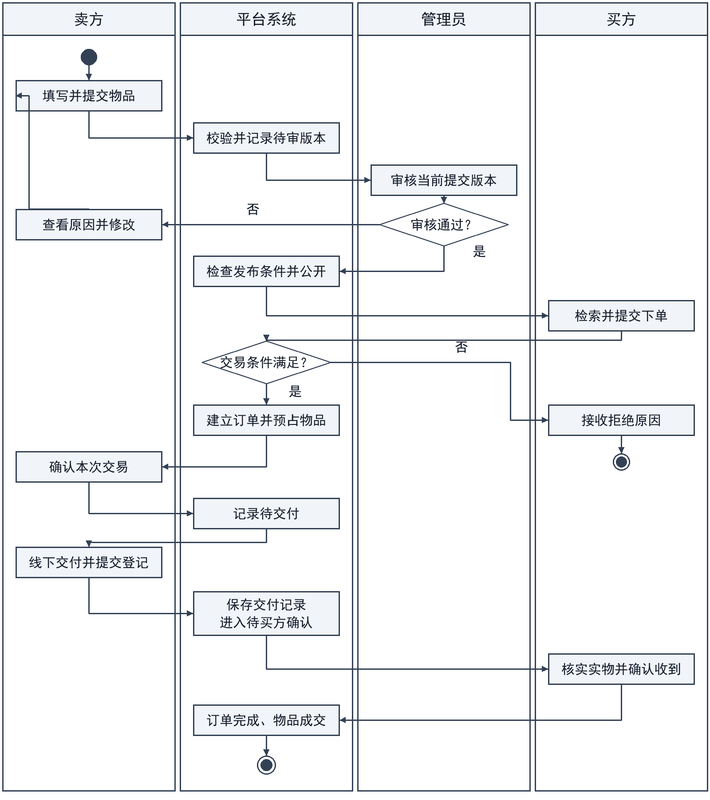

# 校园二手交易与物品流转平台需求规格说明书

本说明书规定校园二手交易与物品流转平台的业务范围、用户任务、交易规则及管理权限，为系统分析、交互设计和需求验收提供依据。

## 1 项目概述

### 1.1 业务问题与项目背景

校园教材、学习工具、数码配件和生活用品具有阶段性使用特点。平台面向校园内部用户，将闲置物品的信息发布、检索咨询、交易确认和线下交付记录集中管理，并通过评价、举报和审核处置维护交易秩序。平台以单件实物交易为对象，重点解决信息难以集中发现、同一物品重复承诺、交付责任不清和违规处置影响既有订单等问题。

### 1.2 业务目标与成功指标

- 信息可发现：用户能够按关键词和分类找到符合公开条件的物品，查看完整描述，并向卖方咨询。

- 交易不重复：同一物品至多关联一笔有效订单；重复提交不增加订单，竞争失败不留下额外占用。

- 过程可追踪：审核、接单、交付登记、收货确认和争议处置均可关联原物品、订单与操作记录。

- 责任可区分：卖方登记交付，买方确认收到；管理员负责治理和争议结案，不得冒用当事人身份确认收货。

### 1.3 涉众、业务角色与确认责任

买方和卖方是校园用户在具体交易中的身份，同一账户可以在不同交易中承担不同身份。权限以对象归属和订单阶段判断，不因拥有某种身份便可操作他人的记录。

- 访问者：浏览公开物品并申请注册；不能执行发布、下单或其他需认证的操作。

- 校园用户：完成校园身份核验后使用交易服务。卖方对物品描述和交付登记负责，买方对购买意图和收货确认负责；双方可查看本人交易并参与争议处理。

- 管理员：审核校园资格与物品发布，处理举报和争议，实施隐藏、账户限制及恢复，并查看职责范围内的统计。

- 项目成员与课程评阅者：依据业务资料和需求条目检查范围、规则与成果。业务规则变更须保留决定、影响及版本记录。

### 1.4 产品范围、非目标与业务概览

平台包括用户准入、物品发布审核、搜索筛选、收藏咨询、下单确认、线下交付记录、评价举报、账户治理、状态流转及统计。主路径为发布审核、下单预占、卖方接单、线下交付、买方确认和评价；取消与争议处理为交易提供退出路径。

图1-1 系统上下文图

图1-1将信息与业务记录纳入平台边界。实物验货、交付及款项结算由当事人在线下完成，平台记录其操作及处置结果。在线支付、资金托管、快递配送、商业商家入驻、拍卖和多库存销售不属于本期范围。图源及同版PNG位于attachments/A/图源与导出/图1-1_系统上下文图.svg及同名PNG。

### 1.5 资料来源与编写依据

- SR01 选题与功能范围：《实践项目说明(1).pdf》第2页“校园二手交易与物品流转平台”核心功能第1—10项规定功能范围；FR01—FR24承接该范围，具体交易条件由第4章统一规定。

- SR02 结构与分工：仓库initialization/skills/共同大纲.md（v3.3）的分工、图表责任及第1—8章；采用main提交366b8b5中的目录框架。

- SR03 验证与提交：仓库initialization/docs/提交要求对照.md及《学生需求分析与AI智能体使用验证报告.md》“提交材料说明”、A.2—A.8、B.2—B.4。来源原件及规则依据索引位于attachments/A/依据与规则核验记录.md。

- SR04 表达参考：《自习室预约管理系统需求分析报告.docx》封面日期2025年11月5日，第2—5章仅用于参考功能分组、用例步骤与图文说明形式。

### 1.6 运行条件、外部依赖与约束

用户通过浏览器使用平台，校园资格经平台核验后生效。身份材料仅用于资格审核，不作为公开资料展示。交易依赖线下实物交接，系统确认表示业务记录成立，不表示平台已代为付款或检验物品质量。通知用于告知处理结果，送达失败不撤销已经成立的订单或处置，用户可在本人记录中查询。实现方案不得改变本说明书规定的身份、归属和交易结果。

## 2 用户需求

### 2.1 功能范围、需求清单与优先级

P1表示准入与交易闭环所必需的功能，P2表示支撑使用与治理的功能。优先级用于安排实现顺序，需求清单中的各项能力均属于本期范围。

表2-1 功能需求清单

| 编号 | 角色／触发 | 系统应提供的行为与结果 | 优先级 | 关联 |
| --- | --- | --- | --- | --- |
| FR01 | 访问者 | 注册账户并反馈成功或拒绝原因 | P1 | UC01／BR01 |
| FR02 | 注册用户 | 提交校园身份资料并查询审核结果 | P1 | UC01／BR01 |
| FR03 | 卖方 | 提交包含必要描述和价格的物品供审核 | P1 | UC04／BR02、03 |
| FR04 | 管理员 | 通过或退回待审物品并保留原因 | P1 | UC10／BR03、16 |
| FR05 | 卖方 | 修改本人可修改物品，按变更范围执行重审 | P1 | UC04／BR04 |
| FR06 | 卖方 | 撤下本人尚无有效订单占用的物品 | P2 | UC04／BR05 |
| FR07 | 访问者／校园用户 | 按关键词与分类等条件检索并查看公开详情 | P1 | UC02／BR13、14 |
| FR08 | 校园用户 | 收藏物品并向卖方咨询；本人可查记录 | P2 | UC03／BR14、17 |
| FR09 | 买方 | 双方账户符合条件时下单，唯一建立订单和预占 | P1 | UC05／BR06 |
| FR10 | 卖方 | 接受或拒绝本人收到的待卖方确认订单 | P1 | UC06／BR07 |
| FR11 | 交易当事人 | 按登记、未交付声明及争议条件取消并留痕 | P1 | UC07／BR09 |
| FR12 | 系统 | 按订单终止原因及独立限制决定物品是否可交易 | P1 | UC07、10／BR05、12、13、19 |
| FR13 | 卖方 | 对待交付订单如实登记线下交付 | P1 | UC06／BR08 |
| FR14 | 买方 | 对本人已登记交付订单确认收到物品 | P1 | UC06／BR08、14 |
| FR15 | 交易当事人 | 查询本人的订单详情与处理进度 | P1 | UC06／BR14、16 |
| FR16 | 交易当事人 | 在交易完成后提交符合资格的评价 | P2 | UC08／BR11 |
| FR17 | 校园用户 | 对物品或违规行为提交举报并查本人处理结果 | P2 | UC09／BR15 |
| FR18 | 管理员 | 核查举报、记录结论并实施授权处置 | P2 | UC10／BR15、16 |
| FR19 | 管理员 | 限制或恢复违规账户并记录原因及依据 | P2 | UC11／BR12、16 |
| FR20 | 系统 | 阻止受限账户及其物品建立新交易，保留旧单处理 | P1 | UC11／BR12 |
| FR21 | 管理员 | 按明确统计口径查看发布、成交与治理数据 | P2 | UC12／BR18 |
| FR22 | 系统 | 对审核、关键交易和治理操作保留可关联记录 | P1 | UC04—UC12／BR16 |
| FR23 | 注册用户 | 登录并退出本人会话；会话失效后拒绝需认证的操作 | P1 | UC01／BR01、14 |
| FR24 | 交易当事人／管理员 | 处理未结束订单履约争议、补证及结案 | P1 | UC10／BR15、19 |

### 2.2 用户故事与角色场景覆盖

用户故事说明角色希望获得的业务价值，用于安排需求优先级；用例说明实现该目标时的触发、前提、交互、异常与结果。两者通过FR和UC编号关联，允许一对多或多对一；具体步骤见2.3—2.4，业务规则统一引用第4章。

- US01 发现与沟通：作为校园用户，希望检索并咨询目标物品，以判断是否适合购买。关联FR07—08、UC02—03。

- US02 发布与维护：作为卖方，希望提交准确的物品信息并获知审核结果，以便合法、清晰地展示物品。关联FR03—06、UC04、UC10-a。

- US03 建立交易：作为买方，希望一次下单形成唯一订单，避免一件物品被重复承诺。关联FR09、UC05。

- US04-a 交付与收货：作为交易当事人，希望明确接单、交付登记和收货确认的进度，以便完成交接并保留交易凭据。关联FR10、FR13—15、UC06。

- US04-b 取消交易：作为交易当事人，希望在未实际交付且系统允许的阶段取消订单并获知结果，以便结束不再履行的交易。关联FR11—12、UC07。

- US04-c 争议处理：作为交易当事人，希望对未结束订单提交履约争议并获知处理结果，以便恢复履约或结束无法继续的交易。关联FR24、UC10-b。

- US05-a 评价与举报：作为校园用户，希望评价已完成交易或举报违规行为，以便反馈交易体验并维护交易秩序。关联FR16—17、UC08—09。

- US05-b 审核与治理：作为管理员，希望审核物品、处理举报并限制违规账户，以便执行平台规则并保留处置依据。关联FR04、FR18—20、FR22、UC10—11。

- US05-c 运营统计：作为管理员，希望按统一口径查看发布、成交和治理数据，以便掌握平台运行情况。关联FR21、UC12。

- US06 账户与资格：作为校园用户，希望注册、完成校园认证并安全登录和退出，以便使用本人有权访问的交易服务。关联FR01—02、FR23、UC01。

场景覆盖包括正常主流程、权限拒绝、状态变化和异常恢复：访问者核验失败时不能下单；卖方审核退回后可修改重提；买方竞争失败不产生占用；当事人可在允许阶段取消，交付有争议时转处理流程；管理员的隐藏与账户限制不得抹除历史交易。

### 2.3 用例模型及说明位置

图2-1 UML用例图

图2-1按用户目标组织用例。管理员参与UC01中的校园认证审核；校园用户参与UC10中的本人举报、争议与补证。UC01、UC03、UC04和UC10为概览分组，内部子流程分别规定触发、前提和结果。图源及同版导出位于attachments/A/图源与导出/图2-1_UML用例图.svg及同名PNG。

- UC01-a 注册：访问者提交账户资料；账户标识未被占用时建立账户，重复标识或缺少必要资料时拒绝，不授予认证权限。

- UC01-b 校园认证：注册用户提交资格资料；管理员通过后取得认证身份，退回时显示原因，原认证状态不被错误提升。

- UC01-c 登录：已注册用户提交凭据，成功后形成本人会话；凭据错误不登录，未通过校园认证仍不取得交易权限。关联FR23、BR01。

- UC01-d 退出：已登录用户主动退出时终止本人会话；会话失效后不得沿用旧身份操作，重新登录后按当前资格判断权限。关联FR23、BR01。

- UC02 检索浏览：访问者或用户输入条件后返回公开可交易物品；无结果时返回空列表，不展示隐藏、已成交或卖方受限的交易入口。关联FR07。

- UC03-a 收藏：认证用户收藏或取消收藏，维护本人唯一关系；对象不可访问时拒绝，不形成交易占用。

- UC03-b 咨询：认证用户针对物品发起交流，相关双方可查看回复；越权或新增互动受限时拒绝，咨询不构成成交承诺。关联FR08。

- UC08 评价：交易完成后，当事人分别提交一次评价；非当事人、未完成交易及重复提交不得新增评价。关联FR16。

- UC09 举报：用户针对物品、交易或违规行为提交理由及证据并查询本人处理结果。已完成、已取消、已拒绝或已异常终止订单的后续反馈走举报核查，不重新占用物品、不重开订单、不撤销历史成交；核查确有违规时另行采取治理措施。关联FR17—18、UC10-b、BR15—16。

- UC11 限制与恢复账户：管理员依据处置记录限制或恢复账户；限制立即阻止相关新交易，恢复后重新判断全部可交易条件。关联FR19—20。

- UC12 业务统计：管理员选择统计范围，按完成订单及治理记录汇总；不得把预占或交付登记计为成交。关联FR21。

### 2.4 关键详细用例与其他用例摘要

以下用例规定核心流程及业务通过条件。UC04包含发布、关键修改和撤下三个子流程；UC10分别说明发布审核与举报争议处置，二者共享管理入口，不混用触发条件。

#### 2.4.1 UC04 发布与维护物品

参与者与触发：卖方提交新物品、修改本人信息或申请撤下。账户已认证且不受发布限制；修改和撤下还须满足对象归属及订单条件。

（1） 发布：填写标题、分类、描述、价格和图片，系统校验后保存本次提交版本并置为待审，公开列表不展示待审物品。

（2） 修改：无有效订单时，可修改本人描述、图片或价格等关键内容；修改版本重新审核，旧版本的通过结论不沿用。

（3） 撤下：仅对无有效订单的本人物品生效，保留发布与交易历史；再次发布须显式提交并重新审核。

替代与异常：必填缺失或格式错误时保留可安全保留的输入，不生成有效发布；越权、账户受限或占用中撤下均拒绝；同一提交意图重试只产生一次业务效果。

后置结果：新发布或关键修改进入待审；撤下后不可公开交易；失败不改变原物品和有效订单。

业务通过条件：未认证发布被拒绝；待审内容不能下单；有有效订单时不能修改交易标的、价格或撤下；重新提交的审核对象与最新版本一致。 关联：FR03、FR05—06、FR22；BR01—05、BR10、BR13、BR16。

#### 2.4.2 UC05 下单并预占物品

参与者与触发：买方在物品详情确认下单。新意图须满足双方账户有新交易资格、非自买、物品审核通过且无隐藏、撤下、成交及有效占用；已识别的同次操作重试按BR10返回已有结果。

（1） 买方核对描述和价格并提交意图。系统先核验当前登录身份及请求归属，再识别同次操作；已有结果时返回对应回执，不重新执行新下单检查。仅新意图检查双方资格、物品限制及占用。

（2） 系统使订单建立和物品预占同时成立，保存本次物品描述、价格及交易双方信息快照。

（3） 返回待卖方确认的订单标识；双方可以查询本人订单。同次操作尚在处理时返回处理中及查询入口，不另建订单；重试回执附对应订单的当前进度。

替代与异常：新意图遇卖方或买方受限、物品条件变化、自买、越权或竞争失败时拒绝。不同意图不得复用回执，同一意图更改物品或关键内容时拒绝；无权访问的请求不得取得旧回执。

后置结果：成功形成唯一有效订单及对应占用；失败不产生孤立订单或残留占用。

业务通过条件：两人竞争同一物品时至多一笔成功，失败不留占用；成功后丢失响应，再以同次意图重试，应返回原订单而非“已占用”；同次处理中的请求不新增订单；受限卖方物品不能接收新意图。关联FR09、FR15、FR20、FR22；BR06、BR10、BR12—14、BR20。

#### 2.4.3 UC06 确认交易与登记交付

参与者与触发：卖方处理本人待卖方确认订单；接受后双方开展线下交接。各操作必须符合订单当前阶段，订单不是已终止或已完成状态。

（1） 卖方接受订单后，系统记录待交付，物品继续被该订单占用；拒绝则终止订单并按其他限制判断物品可售性。

（2） 双方在线下验货并交接物品及款项后，卖方及时提交交付登记；系统保存记录并进入待买方确认。实际交付尚未登记时，应补登记；对交付事实有分歧时按UC10-b核查。

（3） 买方核实收到物品后由本人确认，系统同时记录订单完成与物品成交，并保留双方查询和评价入口。

替代与异常：非当事人、管理员代确认、交付前收货确认或重复登记均不得新增业务效果；交付争议转UC10-b处理，争议处理期间不能普通取消或自动释放物品。

后置结果：交付登记不等于成交；买方确认后才完成。争议处理可继续履约、确认收到后结案，或异常终止。

业务通过条件：卖方登记后仍不计成交；买方确认后只计一次成交；封禁不剥夺旧订单必要处理权；管理员不能以治理权限代替买方确认收到。 关联：FR10、FR13—16、FR22、FR24；BR07—08、BR10—12、BR15—16、BR19—20。

#### 2.4.4 UC07 取消交易

参与者与触发：当事人申请结束本人待卖方确认或待交付订单，并声明尚未实际交付。卖方拒单与普通取消分别留痕。平台以交付登记、争议标记及该声明判断资格，不自动识别线下事实。

（1） 核对订单、归属及取消影响。仅尚无交付登记、无处理中争议，且当事人声明未实际交付时，才进入普通取消；任何一方报告已实际交付或双方陈述冲突时，阻止普通取消并转争议核查。

（2） 当事人提交原因并确认后，系统再次核对阶段、交付登记及争议标记，将取消结果和解除本订单占用作为同一业务结果记录，并保留操作者、时间和未交付声明。

（3） 重新检查审核、隐藏、撤下、成交事实和卖方账户资格，符合全部条件时才恢复可交易；保留订单历史。

替代与异常：已有交付登记、已结束或争议处理中的订单不得普通取消；实际已交付但未登记的，应补登记或提交争议。取消与交付登记并发时，以系统先成立的合法操作为界；后成立请求拒绝，不覆盖原结果。

后置结果：取消成功不再形成有效占用，但不会解除独立隐藏、撤下或账户限制；拒绝不改变原业务结果。

业务通过条件：已有登记则取消被拒绝；取消先成立则后续交付登记被拒绝；未登记但已报告实际交付时不得普通取消；隐藏或封禁后取消不恢复物品可售。关联FR11—12、FR15、FR22；BR05、BR09—10、BR12—13、BR15—16。

#### 2.4.5 UC10 审核与违规处置

参与者与触发：管理员审核待审发布，或处理用户举报及未结束订单的履约争议；相关校园用户提交本人材料、争议及补证。履约争议限待卖方确认、待交付、待买方确认阶段。

（1） UC10-a发布审核：核对发布资格和当前提交内容，记录通过或退回及原因；通过后仍检查独立隐藏、撤下、成交、账户和占用条件。

（2） UC10-b举报与争议：登记对象、理由和证据。未结束订单的履约分歧进入交易争议；已完成、取消、拒绝或异常终止订单的反馈按UC09一般举报核查，不恢复原订单、不新增占用。

（3） 受理未结束订单争议时保留原阶段及已有占用，标记处理中，指定责任管理员并允许双方补证。一般举报本身不改变订单阶段、占用或成交统计。

（4） 未结束订单争议可恢复履约；已交付事实核实后，由卖方补登记、买方本人确认收到，再完成结案；不能继续履约或消除争议时，管理员作出异常终止并记录原因。

替代与异常：越权、目标不存在或无理由处置均拒绝。证据不足时进入补证核查，不直接判定违规；继续履约失败可转异常终止，不能把争议永久悬置作为处理结果。

后置结果：未结束订单异常终止时解除原订单占用，但物品保持不可交易；核实持有或退还情况后，卖方方可重发审核。已结束订单举报仅追加治理记录，不撤销历史成交。资金由双方线下处理，平台不退款。

业务通过条件：未结束订单争议有责任管理员和结案结果；管理员不得代收货；异常终止不计成交且不直接恢复可售；已完成订单举报不重建占用、不异常终止原订单、不冲减成交。关联FR04、FR17—20、FR22、FR24；BR03、BR12—16、BR18—19。

### 2.5 任务交互、页面流程与反馈

### 2.6 外部接口与人工交接

## 3 领域与数据

### 3.1 统一术语与关键参数引用

### 3.2 核心分析类识别与取舍

### 3.3 对象关系、数量与领域模型

### 3.4 对象职责与用例覆盖

### 3.5 关键数据字典与记录生命周期

## 4 规则与权限

### 4.1 允许、禁止与计算规则

以下规则统一约束用例、状态变化、交互和验收。规则条件同时适用时，应满足全部条件；旧订单的必要处理权按BR12保留。

- BR01 校园准入：注册、校园认证和登录分别处理。未认证或会话失效时不能执行受限操作；公开浏览不要求认证。

- BR02 发布内容：单件实物须具备标题、分类、描述、正数人民币价格和必要图片；本期不含免费赠送及多库存销售。

- BR03 审核门槛：物品仅在当前版本审核通过、未隐藏、未撤下、未成交、无有效占用且卖方未受限时公开交易。审核通过不解除其他限制。

- BR04 关键修改：描述、图片和价格等关键修改重新审核；有效订单存在时禁止改变标的及约定价格。旧审核结论不得用于新关键版本。

- BR05 撤下与重发：本人无有效订单的物品可撤下；撤下不删除历史。再次发布需显式提交并审核，不由订单终止自动触发。

- BR06 唯一占用：单件物品至多一笔有效订单，禁止自买。有效订单指已建立且未取消、拒绝、异常终止或完成的订单；建立订单与预占必须同时成立。

- BR07 接单：卖方接受后进入待交付，拒绝则终止本订单；物品是否重新可售须检查全部独立条件。

- BR08 交付与完成：卖方登记待交付订单；平台保存记录后待买方确认。仅该订单买方可确认收到，订单完成与物品成交同时成立；管理员不得代确认。

- BR09 普通取消：待卖方确认或待交付阶段，尚无交付登记、无处理中争议且当事人声明未实际交付时，才可普通取消。已实际交付应补登记；任一方报告已交付或陈述冲突时先转争议。取消与登记以系统先成立的合法操作为准，后续相冲突请求拒绝。

- BR10 重复与竞争：先核验当前身份及请求归属，再按操作者、对象、操作和意图识别重复；已有结果返回原回执，不重跑新操作条件，处理中返回进度。同意图关键内容冲突则拒绝；仅新意图检查资格、限制、阶段及占用。并发同次意图最多成立一次，失败不覆盖已有结果。

- BR11 评价：完成订单的双方各可评价一次；非当事人、未完成及异常终止交易不能新增成交评价，重复提交不追加。

- BR12 账户限制：受限账户及其物品不得建立新交易，不得新发布、收藏或发起新咨询；保留旧单查询、BR09允许的取消、交付、收货、旧成交评价及举报权。未结束订单争议按BR15受理；恢复资格不解除隐藏或撤下。

- BR13 展示与限制：公开交易列表只展示符合BR03的物品；本人历史与授权治理查询仍可读。解除占用、解封或结案不抹除成交事实，也不直接解除独立限制。

- BR14 归属与访问：用户仅操作本人物品和本人参与的订单；咨询仅双方可见。管理员只在审核或治理必要范围访问相关记录，并保留访问依据。

- BR15 举报与争议：举报须关联对象及非空理由，证据可补充，举报不等于违规成立。履约争议仅限待卖方确认、待交付和待买方确认订单；受理后保留原阶段及已有占用，交管理员核查。已结束订单反馈按一般举报处理，不新增占用、不重开订单。

- BR16 历史与依据：审核、交易、处置与争议记录保留操作者、对象、时间、原因和结果；取消、隐藏、封禁及异常终止不直接删除历史。

- BR17 收藏与咨询：同一用户对同一物品的收藏关系唯一；取消收藏不修改物品。收藏和咨询均不形成占用或成交承诺。

- BR18 成交统计：按完成订单去重计算成交笔数和约定金额；预占、交付登记、取消、拒绝及异常终止不计成交。后续隐藏不撤销历史成交。

- BR19 争议出口：仅对BR15中的未结束订单，可恢复履约、按登记与买方确认顺序完成结案，或由管理员异常终止。恢复须记录双方认可安排；异常终止释放订单占用，但物品保持不可交易，核实实物归属后重发审核。已结束订单举报不改变历史成交，不自动退款、不代收货。

- BR20 交易快照：订单保存成立时的物品描述、约定价格及双方信息快照，资料后续修改不回写历史约定。重复收货或结案不重复计成交。

### 4.2 角色、对象范围与状态权限

权限须同时满足角色、对象归属和当前业务阶段。管理员的治理权不包含买卖双方的事实确认权。受限账户保留旧订单必要权利，但不能据此恢复新交易资格。

表4-1 角色与对象权限矩阵

| 操作 | 访问者 | 正常校园用户 | 受限账户 | 管理员 |
| --- | --- | --- | --- | --- |
| 公开浏览 | 允许 | 符合BR03 | 保留浏览 | 治理查询另授权 |
| 发布／修改／撤下 | 禁止 | 本人；BR01—05 | 禁止新发布和公开维护 | 审核或隐藏，不冒用卖方 |
| 收藏／新咨询 | 禁止 | 本人关系／相关对话 | 禁止新增；旧记录可查 | 不默认查看全部私聊 |
| 新下单 | 禁止 | 双方未受限；BR06 | 本人及其物品均禁止 | 不得以治理身份代下单 |
| 接单／取消旧单 | 禁止 | 仅当事人；取消按BR09 | 保留原阶段权利 | 争议终止按BR19 |
| 登记交付／收货 | 禁止 | 卖方登记；买方确认 | 保留既有订单权利 | 禁止代登记或代收货 |
| 查看私有记录 | 禁止 | 仅本人参与记录 | 保留本人历史 | 仅治理必要范围并留痕 |
| 评价／举报／争议 | 禁止 | 本人评价／举报；争议限未结束订单 | 保留旧成交评价及维权 | 核查、补证与结案 |
| 认证／物品审核 | 禁止 | 提交本人资料或物品 | 不能绕过限制重提 | 按职责审核当前版本 |
| 隐藏／限制／恢复 | 禁止 | 禁止 | 禁止 | 需授权、原因和记录 |
| 异常终止争议订单 | 禁止 | 未结束订单：申请、补证 | 保留参与权 | 仅BR15阶段；按BR19处置 |
| 业务统计 | 禁止 | 无全局统计权限 | 禁止 | 按职责范围；BR18 |

### 4.3 条件组合、优先级与冲突处理

先核验当前身份和对象／请求归属，再按BR10识别重复：已有回执则返回，处理中则查询，不因后续占用或账户限制改写原结果。仅新意图继续检查资格、审核、独立限制、订单阶段及占用；取消另查未交付声明和争议标记。失败不覆盖其他请求已有结果。

表4-2 关键条件组合及业务结果

| 情境 | 条件 | 处理结果 | 规则 |
| --- | --- | --- | --- |
| C01 正常下单 | 双方有资格、物品可交易 | 一笔订单与一个占用同时成立 | BR03、06 |
| C02 两人竞争／重复 | 同次重试与其他买方新意图区分 | 同次回原结果；新意图竞争失败不占用 | BR06、10 |
| C03 封禁卖方 | 在售物品的卖方受限 | 拒绝新订单；不影响已有订单闭合 | BR12、13 |
| C04 解封卖方 | 账户恢复，其余条件各自检查 | 全部满足才可下单；隐藏或撤下仍有效 | BR03、12 |
| C05 隐藏或封禁后取消 | 本人、无登记及争议，声明未实际交付 | 旧单终止；物品仍受独立限制 | BR09、13 |
| C06 取消与登记竞争 | 以系统先成立的合法操作为界 | 只成立一个相容结果；另一请求拒绝 | BR08—10 |
| C07 已登记交付 | 本人尝试普通取消或管理员代收货 | 均拒绝；保留原结果，可进入争议 | BR08、09 |
| C08 封禁后旧单收货 | 该订单买方、阶段正确 | 允许完成一次；账户仍受限 | BR08、12 |
| C09 争议恢复／完成 | 仅未结束订单；恢复或本人确认收到 | 恢复时清除标记；完成前须有交付登记 | BR15、19 |
| C10 争议异常终止 | 未结束订单，管理员核查后记录依据 | 不计成交；物品不可直接恢复销售 | BR18、19 |
| C11 已交付未登记 | 当事人报告已交付或双方陈述冲突 | 阻止普通取消；补登记或争议核查 | BR08、09、15 |
| C12 已完成订单举报 | 成交后提交违规反馈 | 追加举报治理记录；不重占用、不改成交 | BR15、16、18、19 |

## 5 行为与状态

### 5.1 核心业务活动与角色交接

图5-1展示发布、下单、登记和完成的成功主路径，图中下单为新意图；重复分支按BR10处理。线下交付后卖方登记，平台记录待买方确认，再由买方确认成交。取消与争议边界分别见BR09、BR15、BR19；同版图源及PNG位于attachments/A/图源与导出/图5-1_核心交易主流程泳道图.svg及同名PNG。

图5-1 核心交易主流程泳道图

### 5.2 对象生命周期与状态定义

### 5.3 状态转换、拒绝及异常处置

### 5.4 自动事件、时间边界与竞争情境

### 5.5 关键对象协作与消息顺序

## 6 质量要求

### 6.1 性能、容量与数据一致性

### 6.2 可靠性、安全与隐私

### 6.3 易用性、维护性与扩展

### 6.4 质量情境、指标依据与取舍

## 7 验收与验证

### 7.1 核心需求验收场景与标准

### 7.2 资料来源核对与规则确认

### 7.3 原型走查与实际验证摘要

### 7.4 覆盖、追踪与一致性检查

## 8 基线与人机协作

### 8.1 需求基线、已确认范围与版本

### 8.2 关键人工决定及责任

### 8.3 未决问题、限制与风险

### 8.4 敏捷迭代、演化与变更

### 8.5 AI使用概况与任务约束

### 8.6 附件、证据索引与同步规则
